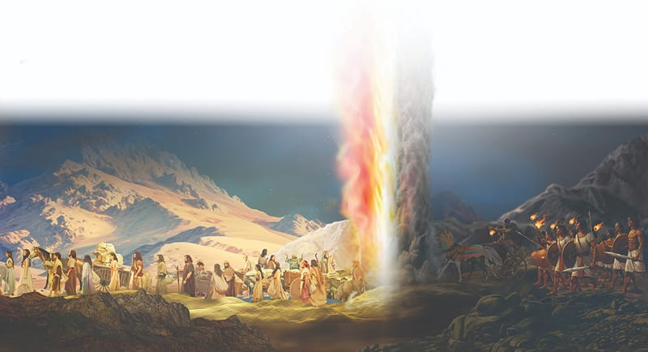

{"style":{"block":{"padding":{"start":"none","end":"none"},"rounded":false},"wrapper":{"padding":{"start":"none","end":"none"}},"image":{"aspectRatio":1.778}}}


The Israelites felt trapped and terrified as they looked at the Red Sea ahead, the towering mountains all around, and the Egyptians behind. In their fear they had forgotten the miracles God had done for them in Egypt.

They wailed and blamed Moses. “What have you done to us? Why did you bring us out of Egypt to die in the desert? There were plenty of graves for us in Egypt. We told you in Egypt, ‘Let us alone! Let us stay and serve the Egyptians.’ Now we will die in the desert” (Exodus 14:11, ICB). Was this Moses’ fault? No! Did he deserve the blame? No! Could he have angrily told them so? Yes!

But Moses didn’t. He knew he was only their earthly leader. God was their real leader, and He was still in control. So Moses stood calmly before the people, for he was not afraid. What did he say to them? **Read Exodus 14:13, 14.**

What beautiful words! They spoke of trust, compassion, patience, and mercy. God knew the Israelites were having a hard time learning to trust, so He would just keep on helping them. He would work another amazing miracle to protect them.

As the Egyptian army charged closer, God’s great cloudy pillar rose into the sky, passed over the Israelites, and came down between them and the Egyptians. On the Egyptian side the cloud created thick darkness. On the Israelite side the wall of cloud gave brilliant light.

The Egyptians were stopped in their tracks by the darkness. They could go no farther!

The Israelites were protected, and their hope grew. God was in that cloud, standing between them and Pharaoh’s army! What a wonderful, trustworthy leader.

God encourages us to “be still and know that I am God” too (Psalm 46:10). When we are frightened, we can stop, take a deep breath, pray, and wait to see what God will do.

{"style": {"text": {"typeface": "Trashbone-Regular", "color": "#3a7daa", "size": "xl"}}}
THINK . . . THEN TALK ABOUT IT:

- Say or sing your memory verse. Which is your favorite phrase?
- What parts of God’s character can be seen in today’s story?

{"style": {"block": {"backgroundColor": "#f3eff2", "padding": {"top": "sm", "start": "base", "end":"sm", "bottom": "sm"}}, "text": {"color": "#885d79"}}}
^[PARENT FAITH TALK:]({"style": {"text": {"typeface": "Trashbone-Regular", "size": "xl"}}}) Share a promise that you would like to remember when you face a problem too big for you.

{"style": {"block": {"backgroundColor": "#f1f6ee", "padding": {"top": "sm", "start": "base", "end":"sm", "bottom": "sm"}}, "text": {"color": "#78a057"}}}
^[PRAY:]({"style": {"text": {"typeface": "Trashbone-Regular", "size": "xl"}}}) Ask God to help you keep trusting Him.

{"style": {"block": {"backgroundColor": "#eef0f1", "padding": {"top": "sm", "start": "base", "end":"sm", "bottom": "sm"}}, "text": {"color": "#56666f"}}}
^[DO:]({"style": {"text": {"typeface": "Trashbone-Regular", "size": "xl"}}}) Draw and cut out a cloud. Color one side black and the other side bright yellow. Use it to tell today’s story to someone.

```=Memory Verse

“ ‘Do not be afraid. Stand still, and see the salvation of the Lord, which He will accomplish for you today.’ ” (Exodus 14:13).

```