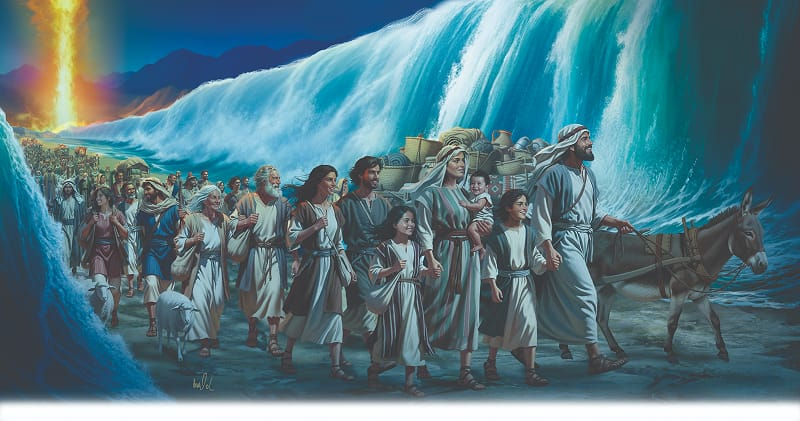

{"style":{"block":{"padding":{"start":"none","end":"none"},"rounded":false},"wrapper":{"padding":{"start":"none","end":"none"}},"image":{"aspectRatio":1.778}}}


As darkness fell, the Egyptians were frustrated by the thick black cloud that blocked their path to the Israelites. On the other side of the protective cloud, light beamed over God’s people as they stood still and waited to see the salvation of the Lord (Exodus 14:13). They didn’t have to stand and wait for long!

Moses gave them God’s command to go forward. Even though there was nothing but deep water in front of them, the Israelites hurried to obey God’s unusual command.

When Moses reached the shimmering water, he followed God’s orders and stretched out his rod toward the sea. Instantly a mighty wind blew. It carved out a deep path as the water rolled up in a wall on either side. What happened next? **Read Exodus 14:22.**

All night long the sound of marching feet continued as the Israelites fled through the sea. God’s cloud followed along behind, shining its light on the foam-capped waves and on the riverbed path.

The Israelites may not have realized it, but they had two trustworthy leaders that night. Moses looked and sounded like their leader. But he was only the human leader who was good friends with God and passed on His messages. God was the trustworthy leader Moses relied on.

The Israelites were learning that God was their trustworthy leader too. They could rely on Him and do what He asked them to do. Prophet Ellen G. White wrote that “in marching down to the very water, they showed that they believed the word of God as spoken by Moses. They did all that was in their power to do, and then the Mighty One of Israel divided the sea to make a path for their feet” (_Patriarchs and Prophets_, p. 290).

The Israelites were learning to trust God and to cooperate with Him, the most trustworthy leader of all!

{"style": {"text": {"typeface": "Trashbone-Regular", "color": "#3a7daa", "size": "xl"}}}
THINK . . . THEN TALK ABOUT IT:

- What would you have thought, said, or done if you had seen this miracle?
- Describe how the Israelites saw “the salvation of the Lord” in this story.
- Isaiah 48:17 says, “I am the Lord your God . . . who leads you by the way you should go.” How does God lead you?

{"style": {"block": {"backgroundColor": "#f9f0ec", "padding": {"top": "sm", "start": "base", "end":"sm", "bottom": "sm"}}, "text": {"color": "#bf6a43"}}}
^[NATURE FAST FACT:]({"style": {"text": {"typeface": "Trashbone-Regular"}}}) Water is extremely powerful. It takes only two feet (60 centimeters) of rushing water to carry away most cars. Yet God has the power to pile it up!

{"style": {"block": {"backgroundColor": "#f1f6ee", "padding": {"top": "sm", "start": "base", "end":"sm", "bottom": "sm"}}, "text": {"color": "#78a057"}}}
^[PRAY:]({"style": {"text": {"typeface": "Trashbone-Regular", "size": "xl"}}}) Praise God for being your trustworthy leader.

{"style": {"block": {"backgroundColor": "#eef0f1", "padding": {"top": "sm", "start": "base", "end":"sm", "bottom": "sm"}}, "text": {"color": "#56666f"}}}
^[DO:]({"style": {"text": {"typeface": "Trashbone-Regular", "size": "xl"}}}) Draw a picture of what you learned in today’s story. What will you include?

```=Memory Verse

“ ‘Do not be afraid. Stand still, and see the salvation of the Lord, which He will accomplish for you today.’ ” (Exodus 14:13).

```