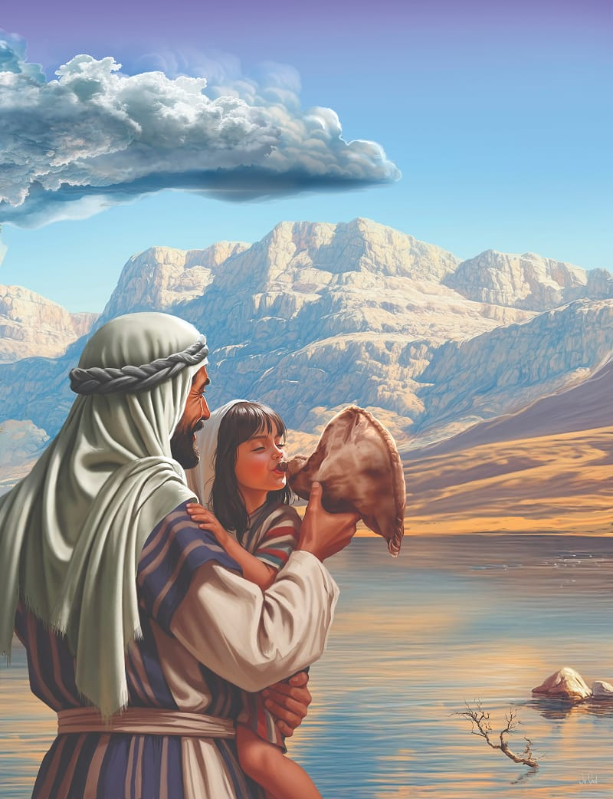
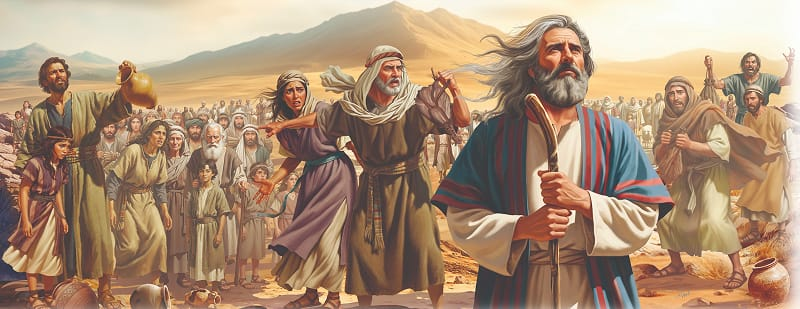

{"style":{"block":{"padding":{"start":"none","end":"none"},"rounded":false},"wrapper":{"padding":{"start":"none","end":"none"}},"image":{"aspectRatio":1.778}}}


{"style": {"block": {"backgroundColor": "#693c87", "padding": {"top": "sm", "start": "base", "end":"sm", "bottom": "sm"}}, "text": {"typeface": "GoodlifeW00-SansCondensed", "color": "#FFFFFF"}}}
God provides for my needs so I can be content and grateful.

{"style": {"text": {"typeface": "ITCAvantGardeStd-BoldCn", "size": "lg"}}}
**^[MEMORY VERSE]({"style": {"text": {"size": "sm"}}})**\
**“Oh, that men would give thanks to the Lord for His goodness, and for His wonderful works to the children of men!” (Psalm 107:8).**

^[Word of the Week—Gratitude:]({"style": {"text": {"typeface": "Trashbone-Regular", "color": "#693c87", "size": "xl"}}})\
Being aware of and feeling grateful (thankful) for the things I have received in life. We can be grateful for such things as having a place to live, friends, family, food, clean water, and clothing. We can be thankful for God’s love! This week, think about the things you are grateful for.

{"style": {"text": {"color": "#3d8b5a", "size": "sm"}}}
This week’s lesson is based on Exodus 15:22-27; Exodus 17:1-7; _Patriarchs and Prophets_, pp. 291, 297, 298; and _The Seventh-day Adventist Bible Commentary_, vol. 1, pp. 573-575. **Extra Reading:** _The Bible Story_, vol. 2, pp. 139, 140, 146.

{"style":{"block":{"padding":{"start":"none","end":"none"},"rounded":false},"wrapper":{"padding":{"start":"none","end":"none"}},"image":{"aspectRatio":1.778}}}


{"style": {"text": {"typeface": "Trashbone-Regular", "color": "#c65a4a", "size": "xl"}}}
Across the Dusty Desert

It had been such a wonderful miracle! God’s people had walked through the sandy bottom of the Red Sea on dry land. They had watched as the towering walls of water crashed down on the Egyptian army. God had delivered them and saved them!

The people sang praises to God as a huge and happy choir. They were safe! They were free! God was so good to them!

With hearts full of grateful joy the Israelites followed the cloud away from the Red Sea and “out into the Wilderness of Shur” (Exodus 15:22). They journeyed beside barren mountains and across sandy wastelands. Water from the water bags quenched their thirst in the desert heat and revived their tired cattle.

But after several days the water bags ran low, and there was no fresh water to be found. The children licked their dry lips. The animals panted and dragged their tired feet. Nobody felt like singing. Instead the worrying began. As the water ran low, so did the Israelites’ faith. They forgot the Red Sea miracle. They worried about where to find water. They worried about not finding water.

Moses was worried too, because he knew the area well. He knew the next pool of water would be bitter and unfit to drink. What was he to do?

As he wondered, he looked up, and there was the cloud! What a comfort. Of course, that’s what he could do! He would follow the cloud, and trust in God’s leading. God would know what to do.

When we find ourselves becoming worried in a difficult situation and our faith runs low, we have a choice to make too. We can worry, or we can remember the good things God has done for us in the past. We can pray and trust Him to care for us now.

{"style": {"text": {"typeface": "Trashbone-Regular", "color": "#c65a4a", "size": "xl"}}}
THINK . . . THEN TALK ABOUT IT:

- The Israelites could have remembered many good things God had done. How many can you think of?
- What does God tell us to do when we are anxious or worried? **Read Philippians 4:6, 7.**

{"style": {"block": {"backgroundColor": "#f1f6ee", "padding": {"top": "sm", "start": "base", "end":"sm", "bottom": "sm"}}, "text": {"color": "#78a057"}}}
^[PRAY:]({"style": {"text": {"typeface": "Trashbone-Regular", "size": "xl"}}}) Ask God to help you rely on Him when you begin to feel worried.

{"style": {"block": {"backgroundColor": "#f8f1ec", "padding": {"top": "sm", "start": "base", "end":"sm", "bottom": "sm"}}, "text": {"color": "#dd8f53"}}}
^[MISSION CHALLENGE:]({"style": {"text": {"typeface": "Trashbone-Regular"}}}) Give the craft you made in Sabbath School to a younger person and tell them the story of God parting the Red Sea.

{"style": {"block": {"backgroundColor": "#f9f0ec", "padding": {"top": "sm", "start": "base", "end":"sm", "bottom": "sm"}}, "text": {"color": "#bf6a43"}}}
^[FAST FACT:]({"style": {"text": {"typeface": "Trashbone-Regular"}}}) The Israelite families would have had a water bag strapped to a donkey. This was usually a whole goatskin carefully sewn up to make it watertight, with an opening at the neck. The opening could be tied shut with a leather strap.

```=Memory Verse

“Oh, that men would give thanks to the Lord for His goodness, and for His wonderful works to the children of men!” (Psalm 107:8).

```