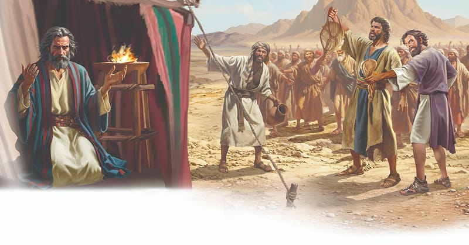

{"style":{"block":{"padding":{"start":"none","end":"none"},"rounded":false},"wrapper":{"padding":{"start":"none","end":"none"}},"image":{"aspectRatio":1.778}}}


As the donkeys clip-clopped along, the water from Marah splish-splashed inside the water bags. It reminded the Israelites that God had provided for their needs, and they were content and grateful. Journeying south, they soon found themselves at a place called Elim, “where there were twelve wells of water and seventy palm trees” (Exodus 15:27). How wonderful to find water again so soon!

Time went by, and their journey continued through the wilderness of Sin, and on to Rephidim, where they made camp. But there was a problem—a big problem! The Bible tells us, “There was no water for the people to drink” (Exodus 17:1). How would they respond to their problem this time? Would they trust God to take care of them?

It wasn’t long until Moses found out. The people came to him and complained bitterly. They demanded, “Give us water, that we may drink” (Exodus 17:2). What else did they say? **Read Exodus 17:3.**

What a terrible thing to accuse Moses of. He had been God’s faithful and patient leader, but they were so ungrateful and discontented. Again.

Moses was distressed by their bad attitude, so he did what he always did. He took the problem to God. He had learned to love and trust God as his leader and friend, so He knew exactly whom to turn to when things got tough.

This was what God was trying to teach the Israelites too. He wanted them to learn to trust Him to provide for their needs instead of grumbling and complaining and getting angry with Moses. Those bad habits needed to be replaced with good habits. Habits such as being grateful and content. God’s people had food, family, friends, a patient leader, and, best of all, God to lead and care for them.

God can help us to be content and grateful too. **Read Philippians 4:11-13** in a simple Bible version to find out how a content and grateful person thinks.

{"style": {"text": {"typeface": "Trashbone-Regular", "color": "#894545", "size": "xl"}}}
THINK . . . THEN TALK ABOUT IT:

- Be honest with yourself. Is there one thing in particular that you grumble and complain about?
- What could you do this week to begin to break that habit and choose to be grateful instead?

{"style": {"block": {"backgroundColor": "#f1f6ee", "padding": {"top": "sm", "start": "base", "end":"sm", "bottom": "sm"}}, "text": {"color": "#78a057"}}}
^[PRAY:]({"style": {"text": {"typeface": "Trashbone-Regular", "size": "xl"}}}) Ask God to help you to turn grumbling into gratitude.

{"style": {"block": {"backgroundColor": "#eef0f1", "padding": {"top": "sm", "start": "base", "end":"sm", "bottom": "sm"}}, "text": {"color": "#56666f"}}}
^[DO:]({"style": {"text": {"typeface": "Trashbone-Regular", "size": "xl"}}}) Who are you grateful for? What could you do or say to show them your gratitude? You might tell, hug, or help them; or give them something special.

```=Memory Verse

“Oh, that men would give thanks to the Lord for His goodness, and for His wonderful works to the children of men!” (Psalm 107:8).

```