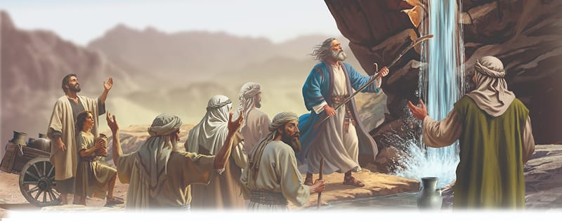

{"style":{"block":{"padding":{"start":"none","end":"none"},"rounded":false},"wrapper":{"padding":{"start":"none","end":"none"}},"image":{"aspectRatio":1.778}}}


The last drops of water were carefully poured out of the water bags. The people licked their dry lips. They whined and complained. They needed water—now!

Even as they grumbled, their loving God was solving the problem. Moses had prayed, and God had told him what to do. Moses quickly obeyed. He grabbed his shepherd’s rod, gathered together some of the elders of Israel, and strode with them toward a large rock. It wasn’t just any rock; God’s presence made that rock special, because He had said, “Behold, I will stand before you there on the rock in Horeb” (Exodus 17:6).

Once Moses had arrived there, he followed the rest of God’s instructions: “You shall strike the rock, and water will come out of it, that the people may drink” (Exodus 17:6). And just like that, sparkling fresh water burst out of the rock in torrents. There was more than enough to meet the needs of that huge crowd of people and their thirsty cattle.

Once again God had performed a mighty miracle to provide for the people. Once again He had shown them that He could easily care for them. Once again He had given their faith an opportunity to grow so that they could learn to live by faith and not their feelings.

The Israelites had let their feelings take them on a roller coaster ride: up and down and round and round. Anger, grumbling, praise, gratitude . . . fear, complaining, thankfulness, distrust . . .

God wanted to get His people off the “feelings roller coaster” so they could be content, even when they had problems.

God also wants us to get off the “feelings roller coaster” and be content. What would He love to hear us say? **Read Philippians 4:11, last part.**

{"style": {"text": {"typeface": "Trashbone-Regular", "color": "#3a7daa", "size": "xl"}}}
THINK . . . THEN TALK ABOUT IT:

- **Read Matthew 6:25, 26.** What does this verse tell you about God’s care for you?
- Think about how Moses had to strike the rock, but God was right there to make the water flow (Exodus 17:6). Both Moses and God did something. God provides our food and water, but what do people need to do? Think of gardeners, farmers, town planners, and so forth.

{"style": {"block": {"backgroundColor": "#eef0f1", "padding": {"top": "sm", "start": "base", "end":"sm", "bottom": "sm"}}, "text": {"color": "#56666f"}}}
^[DO:]({"style": {"text": {"typeface": "Trashbone-Regular", "size": "xl"}}}) Look up a Bible map and plot the course the Israelites have taken in this lesson (Marah, Elim, Rephidim). Retell what happened in each place. Find out where your water comes from.

{"style": {"block": {"backgroundColor": "#f1f6ee", "padding": {"top": "sm", "start": "base", "end":"sm", "bottom": "sm"}}, "text": {"color": "#78a057"}}}
^[PRAY:]({"style": {"text": {"typeface": "Trashbone-Regular", "size": "xl"}}}) Praise God for providing for your needs. Ask Him to help you to be content with what He provides.

{"style": {"block": {"backgroundColor": "#f3eff2", "padding": {"top": "sm", "start": "base", "end":"sm", "bottom": "sm"}}, "text": {"color": "#885d79"}}}
^[PARENT FAITH TALK:]({"style": {"text": {"typeface": "Trashbone-Regular", "size": "xl"}}}) Share ways God helps you to stay content.

```=Memory Verse

“Oh, that men would give thanks to the Lord for His goodness, and for His wonderful works to the children of men!” (Psalm 107:8).

```