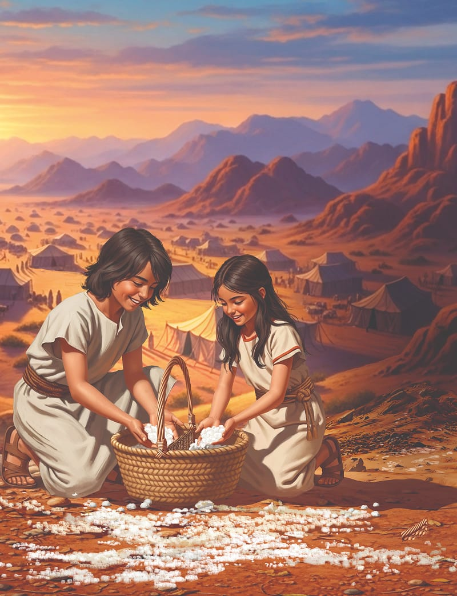

{"style":{"block":{"padding":{"start":"none","end":"none"},"rounded":false},"wrapper":{"padding":{"start":"none","end":"none"}},"image":{"aspectRatio":1.778}}}


{"style": {"block": {"backgroundColor": "#894545", "padding": {"top": "sm", "start": "base", "end":"sm", "bottom": "sm"}}, "text": {"typeface": "GoodlifeW00-SansCondensed", "color": "#FFFFFF"}}}
God is gracious every day, even when we forget how He has provided for us in the past.

{"style": {"text": {"typeface": "ITCAvantGardeStd-BoldCn", "size": "lg"}}}
**^[MEMORY VERSE]({"style": {"text": {"size": "sm"}}})**\
**“You open your hand and satisfy the desire of every living thing” (Psalm 145:16).**

^[Word of the Week—Provide:]({"style": {"text": {"typeface": "Trashbone-Regular", "color": "#894545", "size": "xl"}}})\
Make available for use; supply.

{"style": {"text": {"color": "#3d8b5a", "size": "sm"}}}
This week’s lesson is based on Exodus 16; Numbers 11:4-23 and 31-34; _Patriarchs and Prophets_, pp. 292-297 and 377-382; _The Seventh-day Adventist Bible Commentary_, vol. 1, pp. 577-591. **Extra Reading:** _The Bible Story_, vol. 2, pp. 141-145.

{"style":{"block":{"padding":{"start":"none","end":"none"},"rounded":false},"wrapper":{"padding":{"start":"none","end":"none"}},"image":{"aspectRatio":1.778}}}


{"style": {"text": {"typeface": "Trashbone-Regular", "color": "#8d575c", "size": "xl"}}}
Grumbling and Groaning

Worried moms and dads peered into food bags and sighed. They were almost empty. They scanned the desert, looking for plants to eat, but there were hardly any to be found in the dry wilderness. Getting up early, they searched for animals to hunt, but there were none. What would they do?

It had been one whole month since God had freed His precious people from slavery in Egypt. A little while later God had provided water in the desert when they were parched and thirsty. God had proved to them that He would provide everything they needed.

But as the people looked at the barren, sandy desert all around them, they thought only of their hungry tummies. Before long they were grumbling and complaining again. Soon complaining rumbled through the whole camp, like thunder in a storm. What did they say to poor Moses and Aaron? **Read Exodus 16:3.**

If only they had remembered God’s promise to be their God, and the way He had provided for them in the past. If only they hadn’t forgotten His many miracles: protection from the plagues; the Passover night; the cloud that led and protected; the Red Sea crossing; and the bitter water made sweet. They forgot that remembering God’s past blessings helps us trust Him with today’s problems.

But Moses hadn’t forgotten. Once again he chose to do what he always did. He talked to God about the problem. And God answered with a beautiful promise. He said, “I will rain bread from heaven for you” (Exodus 16:4). Wow! Imagine bread falling from the sky like droplets of rain. God is so good. He would repay grumbling with kindness, and cruel words with a beautiful promise.

{"style": {"text": {"typeface": "Trashbone-Regular", "color": "#8d575c", "size": "xl"}}}
THINK . . . THEN TALK ABOUT IT:

- What blessings has God given you in the past? What are the benefits of remembering them?
- Why do we say grace before we eat?
- Sometimes we forget God’s past blessings. But He graciously showers us with more blessings that give us another reason to trust Him.

{"style": {"block": {"backgroundColor": "#f8f1ec", "padding": {"top": "sm", "start": "base", "end":"sm", "bottom": "sm"}}, "text": {"color": "#dd8f53"}}}
^[MISSION CHALLENGE:]({"style": {"text": {"typeface": "Trashbone-Regular"}}}) Find creative ways to thank different members of your family for who they are and what they do.

{"style": {"block": {"backgroundColor": "#f1f6ee", "padding": {"top": "sm", "start": "base", "end":"sm", "bottom": "sm"}}, "text": {"color": "#78a057"}}}
^[PRAY:]({"style": {"text": {"typeface": "Trashbone-Regular", "size": "xl"}}}) Thank God for the food He provides for you, and ask Him to help you to always be grateful for it.

{"style": {"block": {"backgroundColor": "#eef0f1", "padding": {"top": "sm", "start": "base", "end":"sm", "bottom": "sm"}}, "text": {"color": "#56666f"}}}
^[DO:]({"style": {"text": {"typeface": "Trashbone-Regular", "size": "xl"}}}) Thank those who made your food today. Plan to thank them with your actions as well as your words.

```=Memory Verse

“You open your hand and satisfy the desire of every living thing” (Psalm 145:16).

```