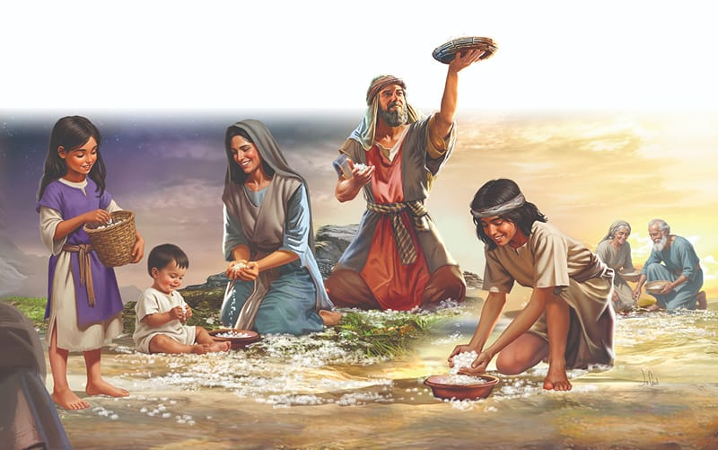

{"style":{"block":{"padding":{"start":"none","end":"none"},"rounded":false},"wrapper":{"padding":{"start":"none","end":"none"}},"image":{"aspectRatio":1.778}}}


While the people continued to grumble about the lack of food in the wilderness, Moses and Aaron called for quiet. They had such wonderful news to share.

When the crowd settled down, Moses and Aaron told them, “And in the morning you shall see the glory of the Lord; for He hears your complaints” (Exodus 16:7). God would rain bread from heaven, to be collected each morning, to feed His people.

While Aaron was still speaking to the people, they looked out toward the wilderness. They saw God’s glory shimmering and shining from the cloud. They had never seen it look so beautiful before. God was reminding them that He was still their gracious leader, and that He would provide for their needs!

Sure enough, it happened the next day, just as God had promised. At first light, dew glistened on the ground. When it melted, what did the people see, and what did they say? **Read Exodus 16:14, 15.**

Moses answered them, “This is the bread which the Lord has given you to eat” (Exodus 16:15). They named God’s tiny flakes of miracle food manna, meaning “What is this?”

The people scurried around excitedly, collecting manna—just enough for each person, because God had promised that a fresh batch would fall the next morning. They should not keep any overnight.

Back in their tents, some people ate it fresh, and some ground the tiny grains into flour to make bread. Others roasted it, and still others boiled it. But no matter how the manna was prepared, the yummy, sweet goodness filled their tummies and made them smile. God had shown them once again that He could open His hand “and satisfy the desire of every living thing” (Psalm 145:16).

{"style": {"text": {"typeface": "Trashbone-Regular", "color": "#693c87", "size": "xl"}}}
THINK . . . THEN TALK ABOUT IT:

- What promise was God continuing to fulfill to His people when He fed them in the wilderness? **Read Exodus 6:7, first part.**
- Where does your food come from? How grateful are you for it?

{"style": {"block": {"backgroundColor": "#f1f6ee", "padding": {"top": "sm", "start": "base", "end":"sm", "bottom": "sm"}}, "text": {"color": "#78a057"}}}
^[PRAY:]({"style": {"text": {"typeface": "Trashbone-Regular", "size": "xl"}}}) Stand in your kitchen and thank God for your food and those who prepare and serve it. Thank Him for the promise “He gives food to every living creature. His love continues forever” (Psalm 136:25, ICB).

{"style": {"block": {"backgroundColor": "#eef0f1", "padding": {"top": "sm", "start": "base", "end":"sm", "bottom": "sm"}}, "text": {"color": "#56666f"}}}
^[DO:]({"style": {"text": {"typeface": "Trashbone-Regular", "size": "xl"}}}) God gave the people sweet, fresh manna to eat. Consider baking or wrapping up a sweet treat to give away to someone who might be sad, lonely, or in need of extra love this week. You might like to tell them this week’s story of God caring for His people.

```=Memory Verse

“You open your hand and satisfy the desire of every living thing” (Psalm 145:16).

```