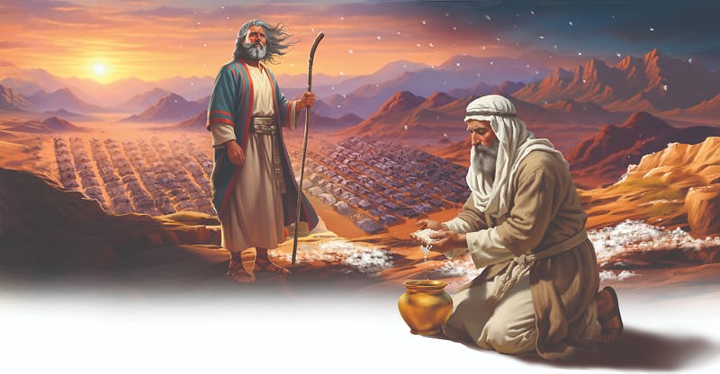

{"style":{"block":{"padding":{"start":"none","end":"none"},"rounded":false},"wrapper":{"padding":{"start":"none","end":"none"}},"image":{"aspectRatio":1.778}}}


God didn’t want His manna miracle to ever be forgotten. Manna would continue to feed the Israelites for the whole 40 years they were to wander across the desert to the Promised Land.

So God decided to have a special reminder of the 40-year manna miracle for future generations to see. What did He tell Moses and Aaron to do? **Read Exodus 16:32.**

What a powerful reminder that must have been. And it wasn’t a smelly reminder crawling with maggots either! Many years later those same little white seeds that tasted “like wafers made with honey” (Exodus 16:31) still looked as fresh as the day they fell from heaven and rested on the dewy ground.

Imagine being able to see that manna-filled jar as a lasting reminder of God’s care. Thousands of years later we have a lasting reminder to look at too—the Bible. What a blessing it is to read the Bible story of how God fed His people every day in the wilderness. Why did God put stories like this in the Bible? **Read Romans 15:4.**

God has something else for us to remember from this story too. God sent the people the bread they needed, but He would one day send them the Savior they needed—Jesus. Just as the manna fell from heaven, Jesus “came from God to give life to the world” (_Patriarchs and Prophets_, p. 297). Jesus Himself said, “I am the bread of life. He who comes to Me shall never hunger, and He who believes in Me shall never thirst” (John 6:35).

This doesn’t mean our tummies will never rumble with hunger or our throats will never be raspy and dry. It means that Jesus will feed our hearts and minds with spiritual food. When we learn beautiful truths about what God and His kingdom are like, and how much He loves us, we are eating spiritual food that keeps our love for Him alive.

Jesus will feed us spiritual food every day, just as God fed the Israelites with manna every morning. Both are beautiful miracles from our gracious God!

{"style": {"text": {"typeface": "Trashbone-Regular", "color": "#693c87", "size": "xl"}}}
THINK . . . THEN TALK ABOUT IT:

- What special reminder of God will you take from this story?

{"style": {"block": {"backgroundColor": "#f1f6ee", "padding": {"top": "sm", "start": "base", "end":"sm", "bottom": "sm"}}, "text": {"color": "#78a057"}}}
^[PRAY:]({"style": {"text": {"typeface": "Trashbone-Regular", "size": "xl"}}}) Thank God for each of the things you are grateful for.

{"style": {"block": {"backgroundColor": "#eef0f1", "padding": {"top": "sm", "start": "base", "end":"sm", "bottom": "sm"}}, "text": {"color": "#56666f"}}}
^[DO:]({"style": {"text": {"typeface": "Trashbone-Regular", "size": "xl"}}}) With help from an adult, take photos around your home (or draw) things you would like to remember to be grateful for.

```=Memory Verse

“You open your hand and satisfy the desire of every living thing” (Psalm 145:16).

```