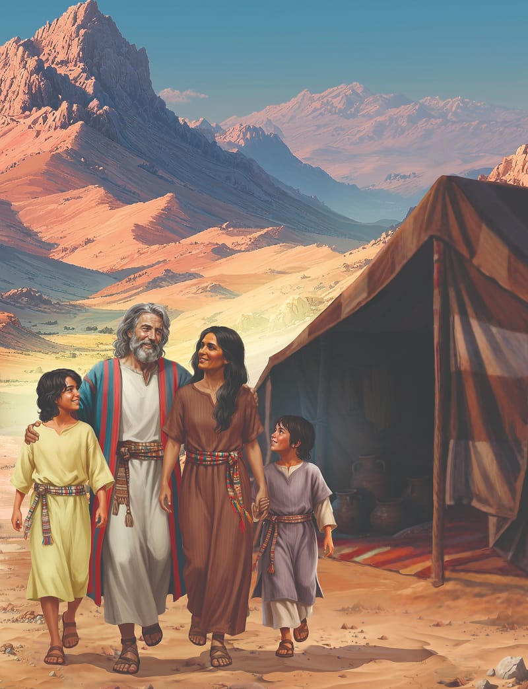
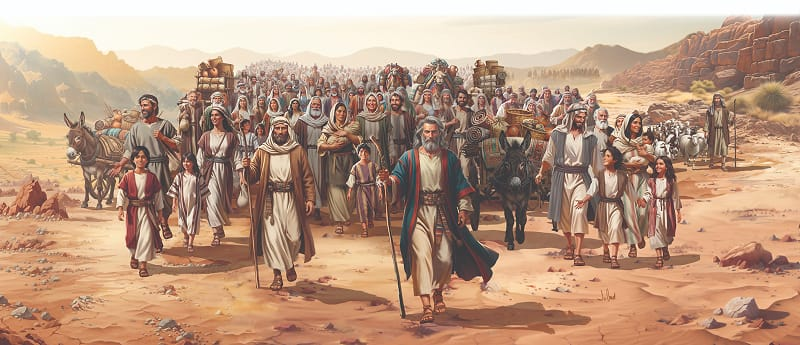

{"style":{"block":{"padding":{"start":"none","end":"none"},"rounded":false},"wrapper":{"padding":{"start":"none","end":"none"}},"image":{"aspectRatio":1.778}}}


{"style": {"block": {"backgroundColor": "#b95c2b", "padding": {"top": "sm", "start": "base", "end":"sm", "bottom": "sm"}}, "text": {"typeface": "GoodlifeW00-SansCondensed", "color": "#FFFFFF"}}}
Families are one of God’s wonderful blessings.

{"style": {"text": {"typeface": "ITCAvantGardeStd-BoldCn", "size": "lg"}}}
**^[MEMORY VERSE]({"style": {"text": {"size": "sm"}}})**\
**“This is My commandment, that you love one another as I have loved you” (John 15:12).**

^[Word of the Week—Relationship:]({"style": {"text": {"typeface": "Trashbone-Regular", "color": "#b95c2b", "size": "xl"}}})\
A connection between people. This can mean being related by blood, such as cousins, uncles and aunts, and grandparents. It can refer to emotional feelings and behaviors between friends and family members.

{"style": {"text": {"color": "#3d8b5a", "size": "sm"}}}
This week’s lesson is based on Exodus 18; _Patriarchs and Prophets_, pp. 300, 301, 383, 384; and _The Seventh-day Adventist Bible Commentary_, vol. 1, pp. 588-591.

{"style":{"block":{"padding":{"start":"none","end":"none"},"rounded":false},"wrapper":{"padding":{"start":"none","end":"none"}},"image":{"aspectRatio":1.778}}}


{"style": {"text": {"typeface": "Trashbone-Regular", "color": "#b95c2b", "size": "xl"}}}
Caring Families

The day came when it was time for the Israelites to leave Rephidim and journey into the Wilderness of Sin. Slowly they were getting closer to the land of Midian, where Moses had seen the burning bush and God had called him to go to Egypt and free the Israelites. That had been just a little more than a year ago.

As Moses journeyed through the desert, he thought of the 40 years he had spent as a shepherd. He thought of Jethro, his father-in-law. But most of all he thought of his family. Oh, how he missed them! His sons, Gershom and Eliezer, must have grown a little taller. His gentle and affectionate wife, Zipporah, would be taking good care of them, but how he longed for them all to be with him again.

Moses’ family had begun the long journey to Egypt with him. But along the way he had made the hard decision to send them back home. Moses loved them too much to let them see the suffering and destruction that he knew would come upon Egypt. He knew that his precious family would be well cared for in Jethro’s household until it was safe for them to be reunited.

God created families to be loving, just as He was. The Bible tells us, “Husbands, love your wives” (Ephesians 5:25), and also says, “And let the wife see that she respects her husband” (Ephesians 5:33). What does John 15:12 tell us?

Moses and his family had built loving, respectful, and you-first relationships. They were a true blessing to one another. We can enjoy the same kinds of relationships in our families too. We may not live in a family with a mom, dad, and children. But no matter what our family looks like, we can build loving and respectful relationships with those we live with.

{"style": {"text": {"typeface": "Trashbone-Regular", "color": "#b95c2b", "size": "xl"}}}
THINK . . . THEN TALK ABOUT IT:

- What advice does God give to children in families? **Read Proverbs 1:8.**
- What do you love about your family’s relationships? Thank each person today.

{"style": {"block": {"backgroundColor": "#f8f1ec", "padding": {"top": "sm", "start": "base", "end":"sm", "bottom": "sm"}}, "text": {"color": "#dd8f53"}}}
^[MISSION CHALLENGE:]({"style": {"text": {"typeface": "Trashbone-Regular"}}}) Share your memory verse you learned last week in a beautiful way (say, write, sing) with someone who might not know God well.

{"style": {"block": {"backgroundColor": "#eef0f1", "padding": {"top": "sm", "start": "base", "end":"sm", "bottom": "sm"}}, "text": {"color": "#56666f"}}}
^[DO:]({"style": {"text": {"typeface": "Trashbone-Regular", "size": "xl"}}}) Be a family “secret spy” this week. Observe what family members do to build good relationships. For example: smile, listen, help, say thank you. Be prepared to share your observations on Friday night.

{"style": {"block": {"backgroundColor": "#f1f6ee", "padding": {"top": "sm", "start": "base", "end":"sm", "bottom": "sm"}}, "text": {"color": "#78a057"}}}
^[PRAY:]({"style": {"text": {"typeface": "Trashbone-Regular", "size": "xl"}}}) Thank God for the people in your family.

```=Memory Verse

“This is My commandment, that you love one another as I have loved you” (John 15:12).

```