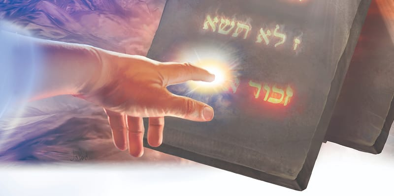

{"style":{"block":{"padding":{"start":"none","end":"none"},"rounded":false},"wrapper":{"padding":{"start":"none","end":"none"}},"image":{"aspectRatio":1.778}}}


Wrapped in a blanket of cloud, Mount Sinai was quiet and still. God had finished speaking His Ten Commandments, His laws of love. Through them He had described the way He loved and lived, and He longed for His people to live the same way because they loved Him.

God’s Ten Commandments are so important that He didn’t just speak them from Mount Sinai. What else did God do? **Read Deuteronomy 9:10.** Imagine being able to do that with your finger! God was showing how important His holy law is; no one could ever erase it.

God also made sure His set of Ten Commandments were recorded in His Word—twice, in fact (Exodus 20:3-17 and Deuteronomy 5:7-21). It is wonderful that anyone who picks up the Bible can learn to love and respect God and others by reading His law for themselves. Our loving God is able to help anyone live His laws of love, especially when they pray, “Open my eyes, that I may see wondrous things from Your law” (Psalm 119:18).

God puts His law somewhere else too. In a beautiful promise He says, “I will put my law in their minds, and write it on their hearts; and I will be their God, and they shall be my people” (Jeremiah 31:33). When God’s law is in our minds and hearts, we will want to love and respect God and other people. What a wonderful thing.

God asks us to treasure the commandments and put them into action. Jesus said, “If you love Me, keep My commandments” (John 14:15). Other Bible versions use the word “do” or “obey” instead of “keep.” We can trust our loving God to help us live the best way, by following His laws of love.

{"style": {"text": {"typeface": "Trashbone-Regular", "color": "#693c87", "size": "xl"}}}
THINK . . . THEN TALK ABOUT IT:

- Which of the Bible verses in today’s lesson is most special to you?

{"style": {"block": {"backgroundColor": "#f1f6ee", "padding": {"top": "sm", "start": "base", "end":"sm", "bottom": "sm"}}, "text": {"color": "#78a057"}}}
^[PRAY:]({"style": {"text": {"typeface": "Trashbone-Regular", "size": "xl"}}}) Praise God for all the places He has written His law.

{"style": {"block": {"backgroundColor": "#eef0f1", "padding": {"top": "sm", "start": "base", "end":"sm", "bottom": "sm"}}, "text": {"color": "#56666f"}}}
^[DO:]({"style": {"text": {"typeface": "Trashbone-Regular", "size": "xl"}}}) If you keep a treasure box of precious things, add an object that reminds you of God’s Ten Commandments. Or consider writing the Ten Commandments in a special way and keeping it as a treasure.

```=Memory Verse

“Lead me in Your truth and teach me, for You are the God of my salvation; on You I wait all the day” (Psalm 25:5).

```