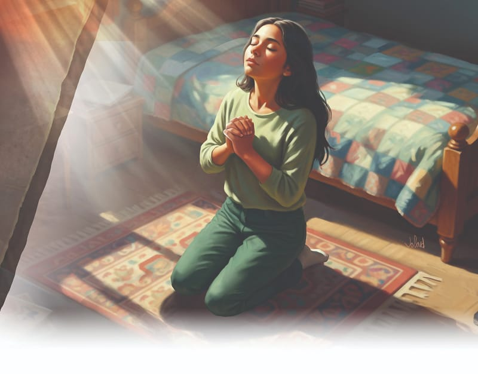

{"style":{"block":{"padding":{"start":"none","end":"none"},"rounded":false},"wrapper":{"padding":{"start":"none","end":"none"}},"image":{"aspectRatio":1.778}}}


God promised that He would put His law in our minds and write it on our hearts (Jeremiah 31:33). God also says, “I will strengthen you, yes, I will help you, I will uphold you with my righteous right hand” (Isaiah 41:10). That is another way of saying that He will give us His power to help us keep His commandments. We can’t keep them by ourselves! And we will get discouraged if we try all by ourselves. We need Jesus.

Jesus tells us to come to Him for help. Many people came to Him when He was on the earth, because they knew He loved them. He loved thieves, tax collectors, sick people, poor people, moms and dads, and children. He loved people who scoffed at Him and those who worshipped Him. He even loved the difficult and dangerous people who came to Him. And he helped them to change. Little by little they began to live by God’s laws of love.

When we come to Jesus in prayer and ask for His help, He will help us change and grow too. Little by little we will learn to live by His Ten Commandments. When we make mistakes and wrong choices along the way, what does God do? **Read 1 John 1:9.** Isn’t that wonderful? God promises to forgive us and clean us up as we learn to love and respect Him and others.

{"style": {"text": {"typeface": "Trashbone-Regular", "color": "#3d8b5a", "size": "xl"}}}
THINK . . . THEN TALK ABOUT IT:

- What do you think the world would be like now if no one knew the Ten Commandments?
- What would it be like if everyone lived by them?

{"style": {"block": {"backgroundColor": "#FFF1FA", "padding": {"top": "sm", "start": "base", "end":"sm", "bottom": "sm"}}, "text": {"color": "#885D7A"}}}
^[FOR YOU, PARENTS:]({"style": {"text": {"typeface": "Trashbone-Regular", "size": "xl"}}}) “God has given us His holy precepts, because He loves mankind. To shield us from the results of transgression, He reveals the principles of righteousness. . . . God desires us to be happy, and He gave us the precepts of the law that in obeying them we might have joy” (Ellen G. White, _The Desire of Ages_, p. 308).

{"style": {"block": {"backgroundColor": "#f1f6ee", "padding": {"top": "sm", "start": "base", "end":"sm", "bottom": "sm"}}}}
^[Friday Night]({"style": {"text": {"typeface": "Trashbone-Regular", "color": "#3d8b5a", "size": "xl"}}})\
\
^[Share and Praise]({"style": {"text": {"typeface": "Trashbone-Regular", "color": "#3d8b5a", "size": "xl"}}})\
• Psalm 19:7-10 is a beautiful psalm about God’s law that has been made into a song called “The Law of the Lord.” Choose a version on YouTube and listen to it.\
• Work together to name the Ten Commandments in order.\
• Sing “Wonderful Words of Life” (_The Seventh-day Adventist Hymnal_, no. 286) and talk about how wonderful it is that God gave His commandments to us to protect us and keep us close to Him and each other.\
\
^[Bible Promise Journal]({"style": {"text": {"typeface": "Trashbone-Regular", "color": "#3d8b5a", "size": "xl"}}})\
• Invite family members to help you write and decorate the memory verse in your special journal.\
\
^[Pray]({"style": {"text": {"typeface": "Trashbone-Regular", "color": "#3d8b5a", "size": "xl"}}})\
• Go on a walk outside and look for things that remind you of each of God’s Ten Commandments. For example: the setting sun for the fourth commandment; something red that reminds you to love God.

```=Memory Verse

“Lead me in Your truth and teach me, for You are the God of my salvation; on You I wait all the day” (Psalm 25:5).

```