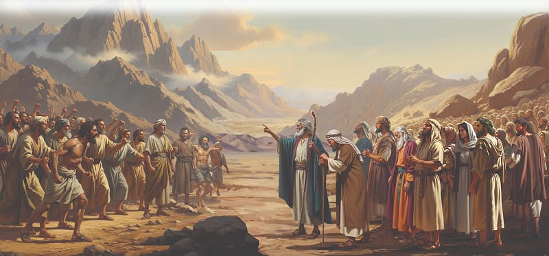

{"style":{"block":{"padding":{"start":"none","end":"none"},"rounded":false},"wrapper":{"padding":{"start":"none","end":"none"}},"image":{"aspectRatio":1.778}}}


Moses stepped over the Ten Commandment tablets that lay shattered on the ground. He pushed his way through the crowd, seized the calf idol, and threw it into the fire, where it melted in the flames. Then Moses took the gold from the fire. When it had cooled down, he crushed it into fine powder and scattered it on the drinking water, and made the people drink it.

Then Moses spoke to his guilty brother, Aaron. What did he say? **Read Exodus 32:21.**

Aaron told Moses not to be angry with him; the people had asked him to make them a god. He said, “So I told the people, ‘Take off your gold jewelery.’ So they gave me the gold. I threw it into the fire and out came this calf!” (Exodus 32:24, ICB).

If only Aaron had bravely stayed committed to God and done what was right, that whole sinful party might never have happened. What advice does God give us when we need to bravely do the right thing? **Read 1 Corinthians 15:58.**

Then Moses called out, “Whoever is on the Lord’s side—come to me!” (Exodus 32:26). The people of the tribe of Levi went and stood beside Moses. Many people were really sorry for the big mistake they had made, and wanted God’s forgiveness. They stood with Moses too.

But there were others who weren’t sorry—not one little bit. They were determined to go right on being rebellious and didn’t want God’s forgiveness. God allowed them to die so that they couldn’t lead anyone else astray, ever again. Second Peter 3:9 says that our loving God is “not willing that any should perish,” but He can’t save those who stubbornly refuse to stop hurting others and themselves.

{"style": {"text": {"typeface": "Trashbone-Regular", "color": "#8d575c", "size": "xl"}}}
THINK . . . THEN TALK ABOUT IT:

- Why do you think the people forgot about God and broke their commitment to Him? How do you think the forgiven people felt? How do you feel when God forgives you?
- What do you think God might do next in the story?

{"style": {"block": {"backgroundColor": "#eef0f1", "padding": {"top": "sm", "start": "base", "end":"sm", "bottom": "sm"}}, "text": {"color": "#56666f"}}}
^[DO:]({"style": {"text": {"typeface": "Trashbone-Regular", "size": "xl"}}}) Circle the names or words in the story that make you think of commitment to our loving God. Write your own name on the page to express your commitment to Him too.

{"style": {"block": {"backgroundColor": "#f1f6ee", "padding": {"top": "sm", "start": "base", "end":"sm", "bottom": "sm"}}, "text": {"color": "#78a057"}}}
^[PRAY:]({"style": {"text": {"typeface": "Trashbone-Regular", "size": "xl"}}}) Thank God for loving and forgiving you the way He did the Israelites who were sorry.

```=Memory Verse

“Commit your way to the Lord, trust also in Him, and He shall bring it to pass” (Psalm 37:5).

```