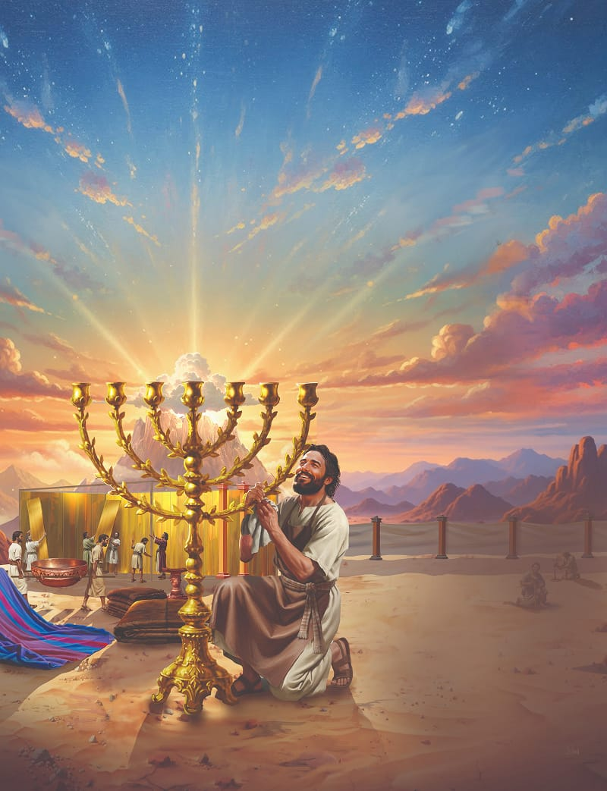
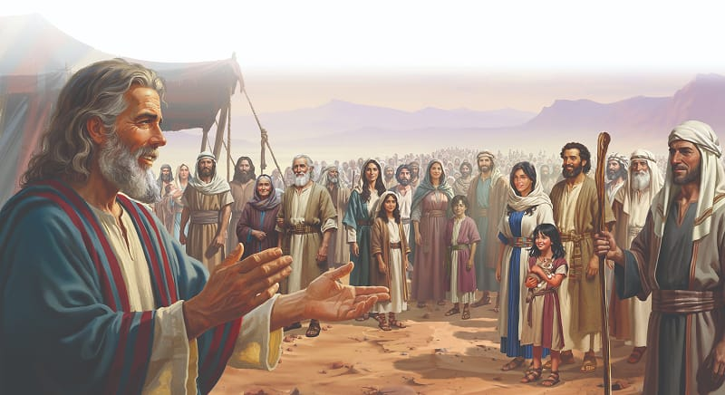

Special Note to Parents: This lesson focuses on the building of the sanctuary, as well as introducing the sanctuary furniture. Next week’s lesson explores the salvation symbolism in the sanctuary.

{"style":{"block":{"padding":{"start":"none","end":"none"},"rounded":false},"wrapper":{"padding":{"start":"none","end":"none"}},"image":{"aspectRatio":1.778}}}


{"style": {"block": {"backgroundColor": "#4693a7", "padding": {"top": "sm", "start": "base", "end":"sm", "bottom": "sm"}}, "text": {"typeface": "GoodlifeW00-SansCondensed", "color": "#FFFFFF"}}}
God wants to be very close to His people.

{"style": {"text": {"typeface": "ITCAvantGardeStd-BoldCn", "size": "lg"}}}
**^[MEMORY VERSE]({"style": {"text": {"size": "sm"}}})**\
**“And let them make Me a sanctuary, that I may dwell among them” (Exodus 25:8).**

^[Word of the Week—Sanctuary:]({"style": {"text": {"typeface": "Trashbone-Regular", "color": "#4693a7", "size": "xl"}}})\
A sacred, holy, and peaceful place where people go to worship God.

{"style": {"text": {"color": "#3d8b5a", "size": "sm"}}}
This week’s lesson is based on Exodus 25–27; 30; 37; 38; 40; _Patriarchs and Prophets_, pp. 343-350. **Extra Reading:** _The Bible Story_, vol. 2, pp. 182-187.

{"style":{"block":{"padding":{"start":"none","end":"none"},"rounded":false},"wrapper":{"padding":{"start":"none","end":"none"}},"image":{"aspectRatio":1.778}}}


{"style": {"text": {"typeface": "Trashbone-Regular", "color": "#246c9f", "size": "xl"}}}
Wonderful News!

Children skipped and zigzagged through the maze of tents with their families as they made their way through the Israelite camp. Everyone was heading toward the wide-open meeting point at the foot of Mount Sinai. God had given Moses another special message for His people.

When the people had all gathered, Moses held up his hands for silence. Then he began to share God’s message with the quiet and curious crowd. What had God asked Moses to tell the people? **Read Exodus 25:8.**

How wonderful that news sounded to the Israelites! They were used to seeing the pillar of cloud every day and knew God was in it. But now He wanted to live right down in the camp with them. He wanted to stay in a special place of worship called a sanctuary. God would be very close to them, and they would come to know Him better. They wouldn’t see Him face-to-face, but He would be there in a very special way.

Moses went on to tell the people how God had given him detailed building plans for the sanctuary. It would be a movable tent church called a tabernacle. It could be packed up and taken with them every time they moved camp.

God was always with the Israelites in the cloud, and He says to us, “I am with you always” (Matthew 28:20). But the sanctuary was to be a special place where the people could worship God, and learn more about His love and His awesome plan to send the promised Rescuer, Jesus.

{"style": {"text": {"typeface": "Trashbone-Regular", "color": "#246c9f", "size": "xl"}}}
THINK . . . THEN TALK ABOUT IT:

- What do you already know about the tabernacle God’s people were to build? What would you like to know?

{"style": {"block": {"backgroundColor": "#f9f0ec", "padding": {"top": "sm", "start": "base", "end":"sm", "bottom": "sm"}}, "text": {"color": "#bf6a43"}}}
^[FAST FACT:]({"style": {"text": {"typeface": "Trashbone-Regular"}}}) There are thousands of wildlife sanctuaries all over the world. India alone has approximately 550. What might a church sanctuary have in common with a wildlife sanctuary? What’s different?

{"style": {"block": {"backgroundColor": "#f1f6ee", "padding": {"top": "sm", "start": "base", "end":"sm", "bottom": "sm"}}, "text": {"color": "#78a057"}}}
^[PRAY:]({"style": {"text": {"typeface": "Trashbone-Regular", "size": "xl"}}}) Thank God that He wants to be close to you! Invite Jesus to come into your heart today.

```=Memory Verse

“And let them make Me a sanctuary, that I may dwell among them” (Exodus 25:8).

```