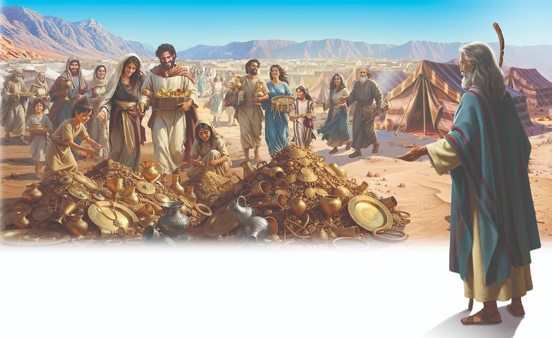

{"style":{"block":{"padding":{"start":"none","end":"none"},"rounded":false},"wrapper":{"padding":{"start":"none","end":"none"}},"image":{"aspectRatio":1.778}}}


The Israelites stood on the sandy desert plain and listened in awe as Moses told them all about God’s new tabernacle home and its furniture. It sounded amazing! To find out what needed to be made, **read the headings in your Bible in Exodus 25-27, 30.**

It would be a beautiful sanctuary for God. He had designed every piece of furniture and decided every detail. They would need gold and silver, brass and precious stones, acacia wood, spices and oil, animal skins, fine linen, and colored thread to make the sanctuary. Where would these materials come from? **Read Exodus 25:2.**

The people hurried back to their tents to bundle up their treasures. They were glad they had so many beautiful, expensive gifts that the Egyptians had given them the night they had left Egypt.

Soon there were piles and piles of gold and silver earrings, bracelets, necklaces and vessels, baskets of fine linen and goat’s hair, and rolls of animal skins.

The people gave their gifts because they really wanted to, not because they had to. They gave so willingly that after a while Moses had to tell them to stop. They had brought more than enough!

God instructs all His children to give in the same way the Israelites did. He says in 2 Corinthians 9:7: “Each one should give, then, what he has decided in his heart to give. He should not give if it makes him sad. And he should not give if he thinks he is forced to give. God loves the person who gives happily” (ICB).

God was very happy with the people’s gifts that day. And He is just as happy when we bring our gifts to Him with a willing heart. Our Sabbath offerings are a special gift to Him. So are the gifts we give to others in need. His Word says: “Anything you did for any of my people here, you also did for me” (Matthew 25:40, ICB).

{"style": {"text": {"typeface": "Trashbone-Regular", "color": "#c65a4a", "size": "xl"}}}
THINK . . . THEN TALK ABOUT IT:

- Why do you think God asked the people to bring gifts?

{"style": {"block": {"backgroundColor": "#f1f6ee", "padding": {"top": "sm", "start": "base", "end":"sm", "bottom": "sm"}}, "text": {"color": "#78a057"}}}
^[PRAY:]({"style": {"text": {"typeface": "Trashbone-Regular", "size": "xl"}}}) Thank God for the opportunity to give gifts to Him.

{"style": {"block": {"backgroundColor": "#eef0f1", "padding": {"top": "sm", "start": "base", "end":"sm", "bottom": "sm"}}, "text": {"color": "#56666f"}}}
^[DO:]({"style": {"text": {"typeface": "Trashbone-Regular", "size": "xl"}}}) Look through your house for things that are valuable to you. How willingly would you give those things if they were needed to build a church?

{"style": {"block": {"backgroundColor": "#f8f1ec", "padding": {"top": "sm", "start": "base", "end":"sm", "bottom": "sm"}}, "text": {"color": "#dd8f53"}}}
^[MISSION CHALLENGE:]({"style": {"text": {"typeface": "Trashbone-Regular"}}}) Use your craft from Sabbath School to share last week’s Bible story with someone who lives near you and may not know God as their friend yet.

```=Memory Verse

“And let them make Me a sanctuary, that I may dwell among them” (Exodus 25:8).

```