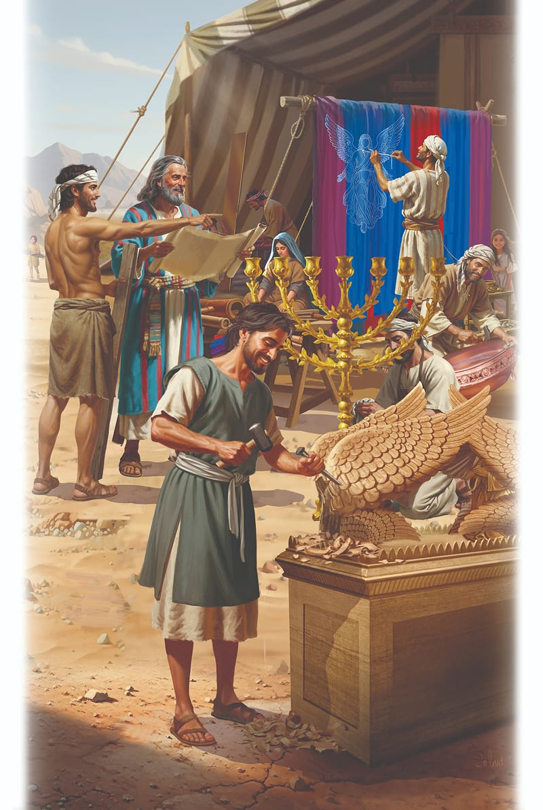

{"style":{"block":{"padding":{"start":"none","end":"none"},"rounded":false},"wrapper":{"padding":{"start":"none","end":"none"}},"image":{"aspectRatio":1.778}}}


The Israelites eagerly worked and watched as the new tent church took shape. They were excited to think that soon God would live so close to them—right in their camp!

Children likely begged their mothers to let them scurry off with their fathers to watch the workers. Maybe they peered over Bezalel’s arm as he unrolled the tabernacle drawings. They would have seen that the tabernacle was to have two rooms: the Holy Place, where the priests would work, and the Most Holy Place, where God would be and where only the high priest was allowed to enter once a year. Little drawings inside the plan would have shown them where special furniture was to be placed in each room.

As the children skipped around the work sites, they would have seen a team of happy workers sanding a special table that would always have bread on it. It would be called the table of showbread. Another team was sculpting a beautiful golden lampstand. Yet another team was carving a gold-covered rectangular pillar called the altar of incense.

The people worked together happily for God. There was no time to grumble and fight and rebel as they sometimes had in the past. They were far too busy for such things! God wants us to work together like this too. The Bible says, “Fulfill my joy by being like-minded, having the same love, being of one accord, of one mind” (Philippians 2:2).

The weeks slid by quickly as the adults worked and the children watched. Then three, four, five months flew by. Each month the excitement grew. The people saw beautiful golden angels take shape on top of the golden ark chest. They saw long boards for the tabernacle frame, and furniture covered in shiny gold.

How wonderful it would be to soon see God’s special sanctuary finished.

{"style": {"text": {"typeface": "Trashbone-Regular", "color": "#246c9f", "size": "xl"}}}
THINK . . . THEN TALK ABOUT IT:

- What words describe people working happily together?
- Where can you work happily together with others? How good are you at this?
- What are the blessings of living and working together happily? **Read Psalm 133:1.**

{"style": {"block": {"backgroundColor": "#f3eff2", "padding": {"top": "sm", "start": "base", "end":"sm", "bottom": "sm"}}, "text": {"color": "#885d79"}}}
^[PARENT FAITH TALK:]({"style": {"text": {"typeface": "Trashbone-Regular", "size": "xl"}}}) Share a time you worked happily with others to achieve something wonderful.

{"style": {"block": {"backgroundColor": "#eef0f1", "padding": {"top": "sm", "start": "base", "end":"sm", "bottom": "sm"}}, "text": {"color": "#56666f"}}}
^[DO:]({"style": {"text": {"typeface": "Trashbone-Regular", "size": "xl"}}}) If possible, go for a nature walk in your neighborhood. Look for examples of things that have been achieved by people or animals working together.

{"style": {"block": {"backgroundColor": "#f1f6ee", "padding": {"top": "sm", "start": "base", "end":"sm", "bottom": "sm"}}, "text": {"color": "#78a057"}}}
^[PRAY:]({"style": {"text": {"typeface": "Trashbone-Regular", "size": "xl"}}}) Ask God to help you cooperate well with others.

```=Memory Verse

“And let them make Me a sanctuary, that I may dwell among them” (Exodus 25:8).

```