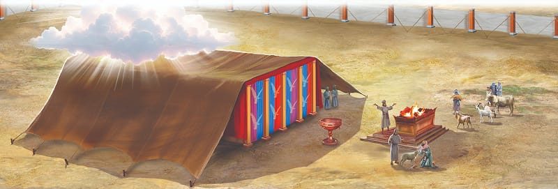

{"style":{"block":{"padding":{"start":"none","end":"none"},"rounded":false},"wrapper":{"padding":{"start":"none","end":"none"}},"image":{"aspectRatio":1.778}}}


The people were still crowding around as they gazed in awe at God’s beautiful sanctuary. Then movement on Mount Sinai caught their eye. The pillar of cloud was moving!

They watched and held their breath as the cloud floated slowly and majestically until it hovered right above the tabernacle. Lower and lower it came. It silently wrapped itself around the tent church as it shone with God’s dazzling glory. Then it filled the tabernacle and rested peacefully on the ark in the Most Holy Place.

The people looked on with wonder and reverent silence. Their loving God had come to live with them. Them! Sinful human beings! They brushed away their tears and thanked God.

God had said, “And let them make Me a sanctuary, that I may dwell among them” (Exodus 25:8). The Israelites had done what God had asked them to do, and now He lived with them—just as He had promised He would.

Our loving God says that He will make a home with us too. Jesus said, “If anyone loves Me, he will keep My word; and My Father will love him, and We will come to him and make Our home with him” (John 14:23). How does God live with us? **Read 1 Corinthians 3:16.** Now, that’s close!

{"style": {"text": {"typeface": "Trashbone-Regular", "color": "#705570", "size": "xl"}}}
THINK . . . THEN TALK ABOUT IT:

- Are there any changes you would like to make in your life, knowing that God lives in you?

{"style": {"block": {"backgroundColor": "#FFF1FA", "padding": {"top": "sm", "start": "base", "end":"sm", "bottom": "sm"}}, "text": {"color": "#885D7A"}}}
^[FOR YOU, PARENTS:]({"style": {"text": {"typeface": "Trashbone-Regular", "size": "xl"}}}) God has the same longing to dwell with your family as he did the Israelites. The psalmist says, “The Lord is near to all who call upon Him” (Psalm 145:18). As you and your precious children call upon Him, inviting His presence to be in your home, He will be there!

{"style": {"block": {"backgroundColor": "#f1f6ee", "padding": {"top": "sm", "start": "base", "end":"sm", "bottom": "sm"}}}}
^[Friday Night]({"style": {"text": {"typeface": "Trashbone-Regular", "color": "#3d8b5a", "size": "xl"}}})\
\
^[Share and Praise]({"style": {"text": {"typeface": "Trashbone-Regular", "color": "#3d8b5a", "size": "xl"}}})\
• Sing or listen to hymn no. 12 in _The Seventh-day Adventist Hymnal_, “Joyful, Joyful, We Adore Thee.” As you sing, try to imagine the whole Israelite camp singing a praise song to God when He filled the tabernacle with His presence.\
• Recite the memory verse for your family and share the things the people did to build God a sanctuary.\
\
^[Bible Promise Journal]({"style": {"text": {"typeface": "Trashbone-Regular", "color": "#3d8b5a", "size": "xl"}}})\
• Invite family members to help you attractively record the memory verse in your journal.\
\
^[Pray]({"style": {"text": {"typeface": "Trashbone-Regular", "color": "#3d8b5a", "size": "xl"}}})\
• As a family, pray prayers of thanks and praise for the way our wonderful God comes close to you.\
\
^[Do]({"style": {"text": {"typeface": "Trashbone-Regular", "color": "#3d8b5a", "size": "xl"}}})\
• Create a mini sanctuary based on what you have learned this week. Consider using small boxes, fabric, gold pens, and other materials. Alternatively, draw the sanctuary.

```=Memory Verse

“And let them make Me a sanctuary, that I may dwell among them” (Exodus 25:8).

```