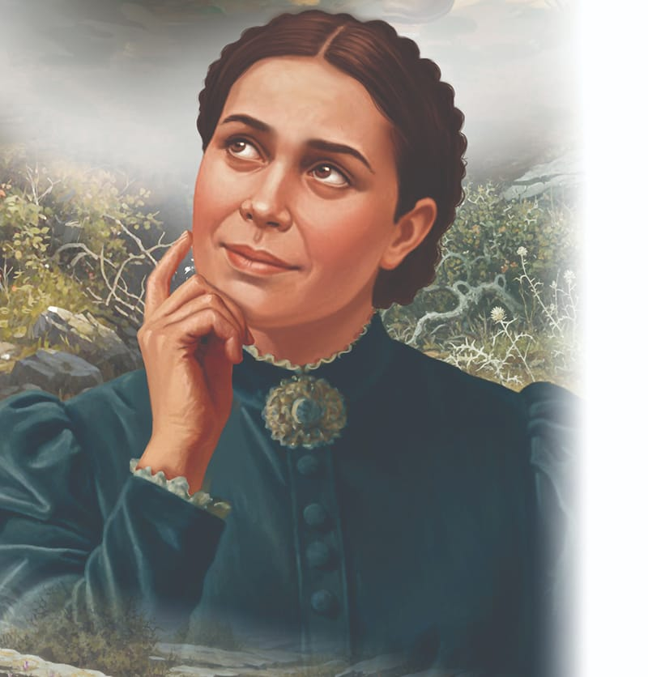
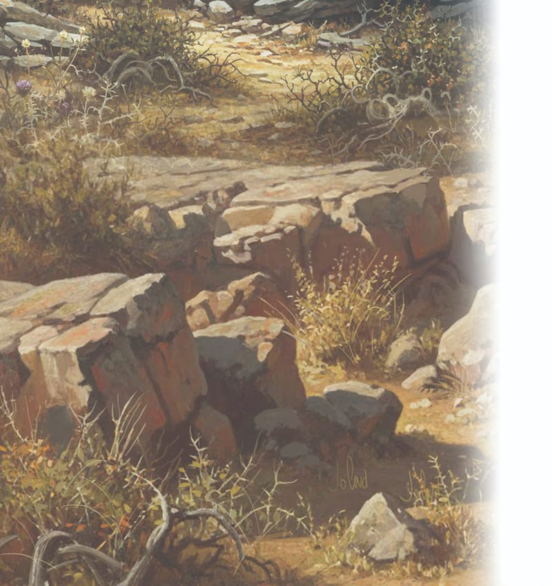
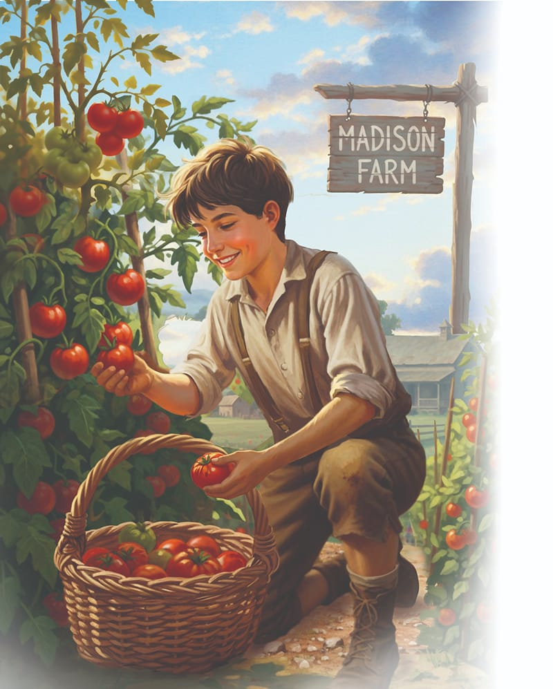

{"style":{"block":{"padding":{"start":"none","end":"none"},"rounded":false},"wrapper":{"padding":{"start":"none","end":"none"}},"image":{"aspectRatio":1.778}}}

Once again Ellen White was busy writing. This time she was writing nine stirring messages to encourage people to go and work for God in the Southern states of North America.

In 1904 Edward Sutherland and his close friend Percy Magan responded to Mrs. White’s call. They gave up their jobs and went to discuss their plans to build a school with Mrs. White. Then they went south and spent six weeks looking for a place to build their school near the city of Nashville.

One day in June 1904 Mrs. White, Mr. Sutherland, Mr. Magan, Mr. Will Palmer, and several other people took a steamboat trip on the Cumberland River near Nashville. The boat suddenly broke down at Neely’s Bend and was towed over to the bank so that repairs could be made.

Mrs. White and Mr. Palmer went ashore to look around. They found themselves on a huge farm that was overgrown with buck brush, and full of stones and gullies. It was a very worn-out and rundown farm!

Mrs. White returned to the boat and said to Sutherland and Magan, “This looks like the place I have seen in vision. This is the place where God wants Sutherland and Magan to start their school.” God had led her to the right place!

{"style":{"block":{"padding":{"start":"none","end":"none"},"rounded":false},"wrapper":{"padding":{"start":"none","end":"none"}},"image":{"aspectRatio":1.778}}}

When the two men inspected the farm, they were upset, for everything they saw looked neglected. It was nothing like the land they imagined buying to build a school. It didn’t look good at all!

The two men had been looking for a small, attractive, fertile farm where healthy plants would grow. They didn’t have the money to buy the huge farm. Discouraged, they sat down on a rock together and cried. But in the end they decided to follow Mrs. White’s advice, for they knew her message was from God. If He wanted them to build a school right there on that huge, ugly farm, they would do it.

{"style":{"block":{"padding":{"start":"none","end":"none"},"rounded":false},"wrapper":{"padding":{"start":"none","end":"none"}},"image":{"aspectRatio":1.778}}}

The land was purchased with every last cent the men owned. Then they got to work, building a school and improving the land. Just like the Israelite temple builders, they followed God’s plan, and He blessed Madison Farm. So much so that Mrs. White always called it “God’s beautiful farm.”

---

{"style": {"text": {"size": "sm"}}}
Adapted from https://www.madisonacademy.com/about-us/the-madison-story.