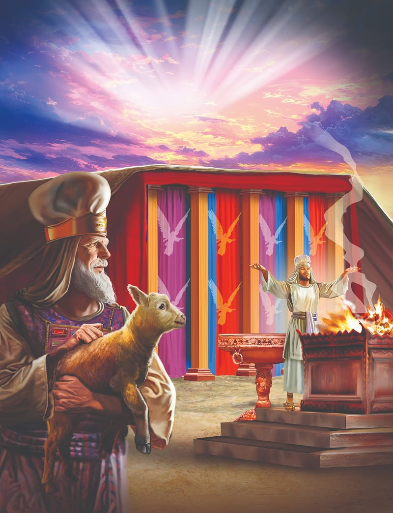
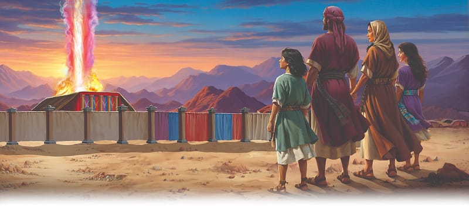

{"style":{"block":{"padding":{"start":"none","end":"none"},"rounded":false},"wrapper":{"padding":{"start":"none","end":"none"}},"image":{"aspectRatio":1.778}}}


{"style": {"block": {"backgroundColor": "#6b5191", "padding": {"top": "sm", "start": "base", "end":"sm", "bottom": "sm"}}, "text": {"typeface": "GoodlifeW00-SansCondensed", "color": "#FFFFFF"}}}
The sanctuary shows God’s plan to save me.

{"style": {"text": {"typeface": "ITCAvantGardeStd-BoldCn", "size": "lg"}}}
**^[MEMORY VERSE]({"style": {"text": {"size": "sm"}}})**\
**“Your way, O God, is in the sanctuary; who is so great a God as our God?” (Psalm 77:13).**

^[Word of the Week—Salvation:]({"style": {"text": {"typeface": "Trashbone-Regular", "color": "#6b5191", "size": "xl"}}})\
The way sinful people are saved and restored to a friendship with God. Because Jesus was innocent and died in the place of every guilty, sinful person, we can be God’s friend now and live forever with Him in heaven.

{"style": {"text": {"color": "#3d8b5a", "size": "sm"}}}
This week’s lesson is based on Exodus 36-38; and _Patriarchs and Prophets_, pp. 352-357.

{"style":{"block":{"padding":{"start":"none","end":"none"},"rounded":false},"wrapper":{"padding":{"start":"none","end":"none"}},"image":{"aspectRatio":1.778}}}


{"style": {"text": {"typeface": "Trashbone-Regular", "color": "#693c87", "size": "xl"}}}
Focused on God

The sleepy Israelites began to stir as the early-morning sun filtered through their tent walls. As they awoke, they remembered: just yesterday God had come right down into the camp to be with them! They stretched, stood up, and pulled the tent flaps open. Yes, God’s presence in the cloud was still there, right over the tabernacle they had built for Him. God was close, just as He had said He would be! Not only was His presence there, but the sanctuary taught and reminded them about God and His plan to save them from sin—the very thing that took them away from God. The more they looked at the sanctuary, the more they went to the sanctuary with their pure lambs, the more they came to understand what God’s Son would one day do for them.

A few weeks later, what did the people see? **Read Numbers 10:11.** That could mean only one thing—it was moving day! Excited children helped their parents pack, roll up tents, and load donkeys.

Meanwhile the Levites were doing a very important job. They were carefully taking God’s tabernacle apart and getting it ready to move. They were the ones God had chosen to do this special work. God could trust them to take care of His precious sanctuary.

The Israelites traveled until “the cloud settled down in the Wilderness of Paran” (Numbers 10:12). There they set up camp, exactly as God had told Moses it should now be done (Numbers 2). The 12 tribes pitched their tents around God’s beautiful tent church. All the tents formed a square, with a clear space for the sanctuary in the middle. The sanctuary was taller than the tents, so every time the people looked toward the middle of the camp, they would see it and be reminded of God’s loving presence.

When we love Jesus, He has the best place, right at the center of our lives too. This means He has our attention, our worship, and our love. The Bible tells us to “set your mind on things above, not on things on the earth” (Colossians 3:2). We’ll be so excited to spend this time with Jesus (learning, praying, thinking, singing . . .) that we’ll want others to know Him and live close to Him too.

{"style": {"text": {"typeface": "Trashbone-Regular", "color": "#693c87", "size": "xl"}}}
THINK . . . THEN TALK ABOUT IT:

- What did God do to show His love for His people in this story?
- How could you give Jesus the most important place in your life today?

{"style": {"block": {"backgroundColor": "#f8f1ec", "padding": {"top": "sm", "start": "base", "end":"sm", "bottom": "sm"}}, "text": {"color": "#dd8f53"}}}
^[MISSION CHALLENGE:]({"style": {"text": {"typeface": "Trashbone-Regular"}}}) Look for a way you could bless or help someone from another country. You may have Christian books you could send, goods or monies you could give to missionaries, or extra coins to give for the Thirteenth Sabbath Offering.

{"style": {"block": {"backgroundColor": "#eef0f1", "padding": {"top": "sm", "start": "base", "end":"sm", "bottom": "sm"}}, "text": {"color": "#56666f"}}}
^[DO:]({"style": {"text": {"typeface": "Trashbone-Regular", "size": "xl"}}}) Use the picture to help you share the message of today’s story with someone—maybe a sibling, a friend, or someone who may be feeling lonely, who would be encouraged by the message.

{"style": {"block": {"backgroundColor": "#f1f6ee", "padding": {"top": "sm", "start": "base", "end":"sm", "bottom": "sm"}}, "text": {"color": "#78a057"}}}
^[PRAY:]({"style": {"text": {"typeface": "Trashbone-Regular", "size": "xl"}}}) Thank God for helping you look to Him.

```=Memory Verse

“Your way, O God, is in the sanctuary; who is so great a God as our God?” (Psalm 77:13).

```