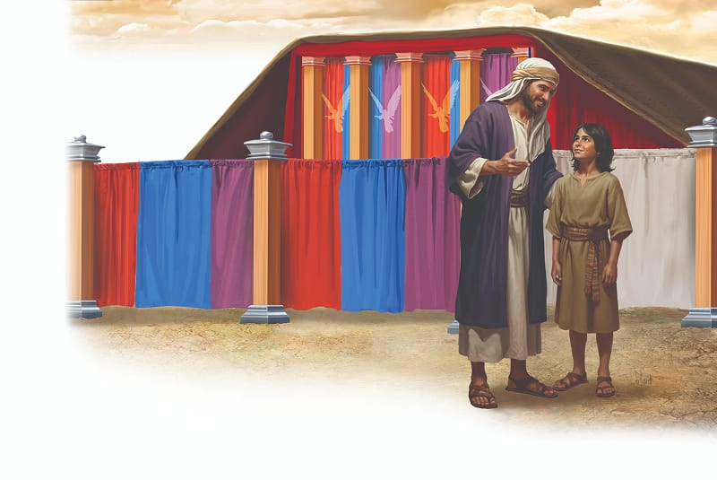

{"style":{"block":{"padding":{"start":"none","end":"none"},"rounded":false},"wrapper":{"padding":{"start":"none","end":"none"}},"image":{"aspectRatio":1.778}}}


The Israelite children never got tired of looking up at God’s magnificent tabernacle in the middle of the wilderness camp. They knew God was right there in the billowing white cloud during the day and in the fiery pillar at night.

But there was so much they didn’t know about this beautiful building with its white linen fence, glistening golden furniture, and colorful curtains. They didn’t know that everything about God’s sanctuary was a beautiful symbol of something very important. A symbol is an object or picture that represents something else. Think about some symbols you know of, and talk about what messages they tell you. Let’s learn about the important sanctuary symbols and what they mean. Let’s look through the eyes of a child. We will imagine his name is Uri, that he is 12 years old, and that he lived in the Israelite camp.

On a warm summer evening Uri snuggled close as his father, Ariel, began to talk about his favorite topic—how much God loves people. Father’s voice was soft and sad as he spoke about the sneaky, slithering snake that had tricked Adam and Eve in the beautiful Garden of Eden. They had believed Satan’s lie and disobeyed God, and that’s how sin entered the world.

Then Father’s voice filled with reverent warmth as he told Uri that God already had a plan to save. Because God loved His people so much, a Savior would one day come to earth and die in place of every sinner. It would happen because God had promised.

The Israelites didn’t know that Jesus would come to earth many hundreds of years later. But they did know they needed a Savior. So what was Uri to do with the yuckiness of sin? How was he to know more about the promised Savior and the work He would do for sinners? His father, Ariel, would show him and teach him.

{"style": {"text": {"typeface": "Trashbone-Regular", "color": "#246c9f", "size": "xl"}}}
THINK . . . THEN TALK ABOUT IT:

- Do you know any symbols that are used by Christians?
- What does salvation begin with? **Read John 3:16.** Pay special attention to the first four words.

{"style": {"block": {"backgroundColor": "#f1f6ee", "padding": {"top": "sm", "start": "base", "end":"sm", "bottom": "sm"}}, "text": {"color": "#78a057"}}}
^[PRAY:]({"style": {"text": {"typeface": "Trashbone-Regular", "size": "xl"}}}) Thank God for loving all people and for offering them salvation through Jesus, the promised Savior.

{"style": {"block": {"backgroundColor": "#eef0f1", "padding": {"top": "sm", "start": "base", "end":"sm", "bottom": "sm"}}, "text": {"color": "#56666f"}}}
^[DO:]({"style": {"text": {"typeface": "Trashbone-Regular", "size": "xl"}}}) Salvation begins with God’s love. Design your own symbol to represent God’s love.

```=Memory Verse

“Your way, O God, is in the sanctuary; who is so great a God as our God?” (Psalm 77:13).

```