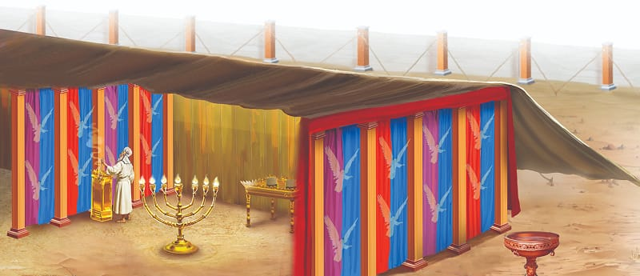

{"style":{"block":{"padding":{"start":"none","end":"none"},"rounded":false},"wrapper":{"padding":{"start":"none","end":"none"}},"image":{"aspectRatio":1.778}}}


Uri tugged his father’s robe as they walked back home. His father stopped and smiled. He knew exactly what his wide-eyed son wanted: another story about the sanctuary. Ariel was honored to have helped the craftsmen lay gold over all the items in the Holy Place, and he never tired of telling Uri about it.

Uri listened in wonder as Ariel described the golden walls that glowed as they reflected the light from the candlestick. Then his father took his staff and drew a picture of the candlestick in the dirt. Its seven curved arms held seven candles with flickering flames that were always lit.

This shining light that Ariel drew was a symbol of Jesus, who said, “I am the light of the world. He who follows Me shall not walk in darkness, but have the light of life” (John 8:12). When we follow Jesus, He tells us to shine too. How will people see us shining? **Read Matthew 5:16.**

Ariel looked into Uri’s eyes and smiled. Did he remember the best part about working with gold? Uri nodded. He would never forget. “Gold is pure,” he told his father. “It can cover something like wood and make it beautiful, just as forgiveness covers our sins.”

As the pair rounded the corner, they were greeted with the sweet smell of manna made into loaves of bread. Uri raced to the front of his tent, eager to gobble up the lunch his mother was making. He watched as the loaves sizzled in the pan. “We have six loaves to share,” Ariel said. “In the Holy Place there are always 12 little loaves of bread on the gold table of showbread, to represent each of the 12 tribes of Israel. Do know why?” Uri thought about the way God fed him and all the people with manna every day. “God will always provide for us?” he asked. Ariel nodded.

Just as God provided bread, He would provide the Savior. The bread was another symbol of Jesus who says, “I am the bread of life” (John 6:35). The Savior would feed people’s minds and hearts with His words in the Bible too. Then, just as the manna helped Uri’s body to grow, Jesus’ words would help people grow to be more like Him.

{"style": {"text": {"typeface": "Trashbone-Regular", "color": "#246c9f", "size": "xl"}}}
THINK . . . THEN TALK ABOUT IT:

- What kind thing can you do today to shine for Jesus?
- What does it mean to eat the “bread of life”?

{"style": {"block": {"backgroundColor": "#FFF1FA", "padding": {"top": "sm", "start": "base", "end":"sm", "bottom": "sm"}}, "text": {"color": "#885D7A"}}}
^[FOR YOU, PARENTS:]({"style": {"text": {"typeface": "Trashbone-Regular", "size": "xl"}}}) “Eternity can never fathom the depth of love revealed in the cross of Calvary. It was there that the infinite love of Christ and the unbounded selfishness of Satan stood face to face. The entire system of Judaism, with its types and symbols, was a shadow of the cross, extending from Calvary back to the gate of Eden, and contained a compacted prophecy of the gospel” (Stephen N. Haskell, The Cross and Its Shadow, p. 5).

{"style": {"block": {"backgroundColor": "#f1f6ee", "padding": {"top": "sm", "start": "base", "end":"sm", "bottom": "sm"}}, "text": {"color": "#78a057"}}}
^[PRAY:]({"style": {"text": {"typeface": "Trashbone-Regular", "size": "xl"}}}) Ask Jesus to help you shine for Him, just as He shines.

{"style": {"block": {"backgroundColor": "#f3eff2", "padding": {"top": "sm", "start": "base", "end":"sm", "bottom": "sm"}}, "text": {"color": "#885d79"}}}
^[PARENT FAITH TALK:]({"style": {"text": {"typeface": "Trashbone-Regular", "size": "xl"}}}) Share a specific time Jesus has fed you spiritually from His Word. Invite your child to share something from the Bible that has fed them too.

{"style": {"block": {"backgroundColor": "#eef0f1", "padding": {"top": "sm", "start": "base", "end":"sm", "bottom": "sm"}}, "text": {"color": "#56666f"}}}
^[DO:]({"style": {"text": {"typeface": "Trashbone-Regular", "size": "xl"}}}) Eat your dinner by candlelight and share the message of the candlestick and the bread with your family.

```=Memory Verse

“Your way, O God, is in the sanctuary; who is so great a God as our God?” (Psalm 77:13).

```