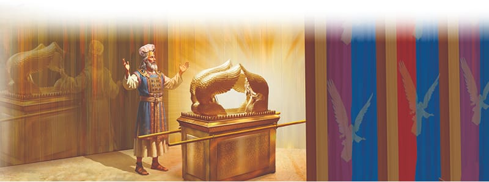

{"style":{"block":{"padding":{"start":"none","end":"none"},"rounded":false},"wrapper":{"padding":{"start":"none","end":"none"}},"image":{"aspectRatio":1.778}}}


As Uri finished his lunch, he watched his mother’s cooking fire go out. The coals glowed hot, and a thin line of smoke drifted upward. Ariel followed his gaze. Quietly he told Uri about the altar of incense in the Holy Place, with its glowing coals of fire and slowly rising incense. It was a symbol of all the prayers that are constantly rising up to God. Prayers of thanksgiving and confession. Prayers for others, for help, and for wisdom.

Jesus would be just like that altar of incense. He takes all of our prayers and presents them as sweet-smelling incense to our loving God. Where does the Bible say Jesus is now, and what is He doing for us? **Read Romans 8:34.** Thank You, Jesus!

As Uri prepared for bed that night, he thought about all the beautiful things he had seen, and the story each item had told. But best of all, he thought about God living right there in camp with Him. “Tell me about the special place where God lives,” he whispered to his father as he climbed into bed.

Ariel drew a candle near. He told Uri about the Most Holy Place, which glowed with God’s brilliant light. This was where the most special piece of sanctuary furniture sat, a beautiful golden chest topped with two magnificent angels. It was called the Ark of the Covenant, as it held God’s law of love, the Ten Commandments. Between the angels was the mercy seat—the place where God Himself was.

“Why is it called a mercy seat?” Uri interrupted. Ariel smiled.

“No matter how hard we try, we will always make mistakes, and sin,” Ariel said. Uri nodded. “God is right here with us, above the law, showing us His justice, mercy, and love. He’s a good, faithful, holy God.”

Uri sighed a happy sigh. He had learned so much about God’s plan of salvation and the promised Savior who would one day take the place of sinners and die for them. His heart was full.

“Your way, O God, is in the sanctuary; who is so great a God as our God?” (Psalm 77:13). Our God and His plan of salvation are very great indeed.

{"style": {"text": {"typeface": "Trashbone-Regular", "color": "#3d8b5a", "size": "xl"}}}
THINK . . . THEN TALK ABOUT IT:

- Why did God put so many symbols of Jesus in the sanctuary?

{"style": {"block": {"backgroundColor": "#f1f6ee", "padding": {"top": "sm", "start": "base", "end":"sm", "bottom": "sm"}}}}
^[Friday Night]({"style": {"text": {"typeface": "Trashbone-Regular", "color": "#3d8b5a", "size": "xl"}}})\
\
^[Share and Praise]({"style": {"text": {"typeface": "Trashbone-Regular", "color": "#3d8b5a", "size": "xl"}}})\
• As a family, sing and pray your way through the plan of salvation in the sanctuary. Assign each family member a specific item/items to pray about:\
• **Gates:** **Read Psalm 100:4**, then sing a praise song together.\
• **Altar of Sacrifice:** Thank Jesus for being your Savior. Give Him your heart.\
• **Washbasin:** Sing the song “Lord, Make Me Clean” (or a similar song on that theme) together as a prayer. Talk about how baptism is also a washing clean for a new life with Jesus.\
• **Candlestick:** Thank Jesus for being the light of the world. Ask Him to help you to shine brightly for Him.\
• **Table of Showbread:** Thank Jesus for feeding you with His Word. Ask Him to help you understand it.\
• **Altar of Incense:** Thank Jesus for mixing His goodness with your prayers, and that God hears.\
• **Ark of the Covenant:** Thank God for His presence and His mercy.\
\
^[Bible Promise Journal]({"style": {"text": {"typeface": "Trashbone-Regular", "color": "#3d8b5a", "size": "xl"}}})\
• Invite family members to help you write and decorate the memory verse in your journal.\
\
^[Do]({"style": {"text": {"typeface": "Trashbone-Regular", "color": "#3d8b5a", "size": "xl"}}})\
• The sanctuary was 100 cubits long by 50 cubits wide. This equals 46 meters (150 feet) long by 23 meters (75 feet) wide. Can you find an open area to measure it out in? If not, research the size of some big things online (a bus, a whale, a garage . . .), and compare it.

```=Memory Verse

“Your way, O God, is in the sanctuary; who is so great a God as our God?” (Psalm 77:13).

```