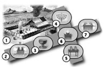

The Bible contains many examples of the four themes we emphasize in prayer. These examples can be found in both the Old and New Testaments and, most importantly, in Jesus’ own example of prayer. These themes are deeply profound, yet they can also be understood by a child.

### The Lord’s Prayer: Matt. 6:9-13

“Our Father which art in heaven [**praise/worship**], hallowed be thy name [**praise**]. Thy kingdom come, thy will be done in earth, as it is in heaven [**supplication for God’s will**]. Give us this day our daily bread [**supplication for personal needs**]. And forgive us our debts, as we forgive our debtors [**confession and humility**]. And lead us not into temptation, but deliver us from evil [**supplication for spiritual victory**]: For thine is the kingdom, and the power, and the glory, for ever [**praise/ thanksgiving**].” (KJV)

“**The Lord’s Prayer was not intended to be repeated merely as a form**, but it is an illustration of what our prayers should be—simple, earnest, and comprehensive. In a simple petition tell the Lord your needs and express gratitude for His mercies. Thus you invite Jesus as a welcome guest into your home and heart.” Child Guidance, p. 524

“We are too sparing of giving thanks. **If the loving-kindness of God called forth more thanksgiving and praise, we would have far more power in prayer**. We would abound more and more in the love of God and have more bestowed to praise Him for. You who complain that God does not hear your prayers, change your present order and mingle praise with your petitions. When you consider His goodness and mercies you will find that He will consider your wants.” Testimonies for the Church, vol. 5, p. 317

### More examples of these biblical prayer themes

- Nehemiah’s Prayer: Neh. 1:5-11
- Children of Israel’s Prayer: Neh. 9
- Solomon’s Prayer: 1 Kings 8
- Daniel’s Prayer: Dan. 9:3-19
- Before/After Pentecost: The Book of Acts

### The Sanctuary Model

“Your way, O God, is in the sanctuary.” Ps. 77:13

1. **Thanksgiving**: We are instructed to “Enter into His gates with thanksgiving, and into His courts with praise.” Ps. 100:4
2. **Confession**: The first stop inside the sanctuary is the altar of sacrifice. Here we confess our sins and confess our belief in Christ, claiming His sacrifice made at the cross. Confession is also a prerequisite for receiving the rain that we desire from heaven. 2 Chron. 6:26, 27; Lev. 4:26; Rom. 10:9-13.
3. **Confession and Cleansing**: Moving to the laver, we ask God to cleanse us (baptize us) through the power of His Word, and we accept the forgiveness He offers. Ex. 30:18-21; Eph. 5:26, 27.
4. **Supplication for Holy Spirit**: Then, entering the Holy Place, we come to the seven-branch candlestick. Here we ask God to baptize us and fill us with His Holy Spirit. Rev. 1:12; Luke 11:13.
5. **Supplication for Spiritual and Physical Bread**: At the table of showbread, we ask God to supply our needs. Most importantly, He is the spiritual bread of life. However, He also promises to provide for our physical bread and temporal needs. John 6:35; Isa. 33:16; Phil. 4:19.
6. **Supplication Through Our Intercessor**: At the altar of incense, Christ’s righteous prayers cover our own, making them acceptable to God. Then, covered by His righteousness, we are able to intercede with Him for others. Rom. 8:26, 34; Isa. 59:16; Phil. 1:3-6.
7. **Thanksgiving in Worship and Praise**: Finally, as we bow in God’s presence, reflecting on all that He has done for us, worship and praise again spring from our lips. Like the disciples after Pentecost, our greatest desire is to testify of what we have seen in Christ. Ps. 150:1, 2; Heb. 10:19-23.

### What Will Be the Result of Such Prayers?

In the Old Testament, God dwelt in the physical sanctuary, or temple. We are God’s temple (1 Cor. 3:16). When we confess our sins (1 John 1:9) and turn to Him in true praise, His Spirit will fill our lives. There will be no room for self or self- righteousness to stand any longer. His glory will fill this place!

“Indeed it came to pass, when the trumpeters and singers were as one, to make one sound to be heard in praising and thanking the Lord . . . that the house, the house of the Lord, was filled with a cloud, so that the priests could not continue ministering because of the cloud; for the glory of the Lord filled the house of God.” 2 Chron. 5:13, 14

“The religious services, the prayers, the praise, the penitent confession of sin ascend from true believers as incense to the heavenly sanctuary, **but passing through the corrupt channels of humanity, they are so defiled that unless purified by blood, they can never be of value with God**. They ascend not in spotless purity, and unless the Intercessor, who is at God’s right hand, presents and purifies all by His righteousness, it is not acceptable to God. All incense from earthly tabernacles must be moist with the cleansing drops of the blood of Christ. He holds before the Father the censer of His own merits, in which there is no taint of earthly corruption. **He gathers into this censer the prayers, the praise, and the confessions of His people, and with these He puts His own spotless righteousness**. Then, perfumed with the merits of Christ’s propitiation, the incense comes up before God wholly and entirely acceptable. Then gracious answers are returned.” Selected Messages, bk. 1, p. 344

“**If we would offer up acceptable prayer, we should realize that in our petitioning we are in the audience chamber of the Most High**. . . . It means much to pray to our Heavenly Father. We come to lay our imperfect tribute of thanksgiving at His feet in acknowledgment of His love and mercy, of which we are wholly undeserving. We come to make known our wants, to confess our sins, and to present to Him His own promises.” Review and Herald, May 28, 1895, par. 2

“No outward observances can take the place of simple faith and entire renunciation of self. But no man can empty himself of self. We can only consent for Christ to accomplish the work. Then the language of the soul will be, **Lord, take my heart; for I cannot give it. It is Thy property. Keep it pure, for I cannot keep it for Thee. Save me in spite of myself, my weak, unchristlike self. Mold me, fashion me, raise me into a pure and holy atmosphere, where the rich current of Thy love can flow through my soul**. It is not only at the beginning of the Christian life that this renunciation of self is to be made. At every advance step heavenward it is to be renewed. All our good works are dependent on a power outside of ourselves. Therefore there needs to be a continual reaching out of the heart after God, a continual, earnest, heartbreaking confession of sin and humbling of the soul before Him. Only by constant renunciation of self and dependence on Christ can we walk safely.” Christ’s Object Lessons, p. 159