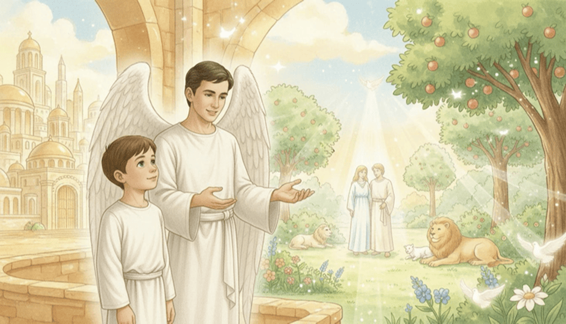
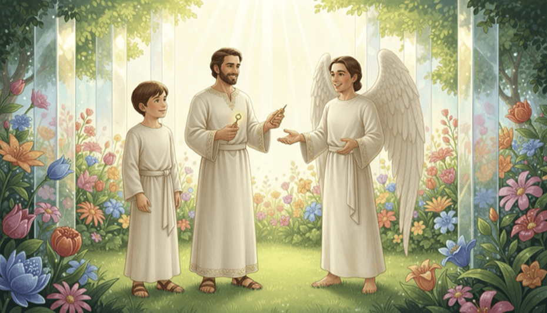
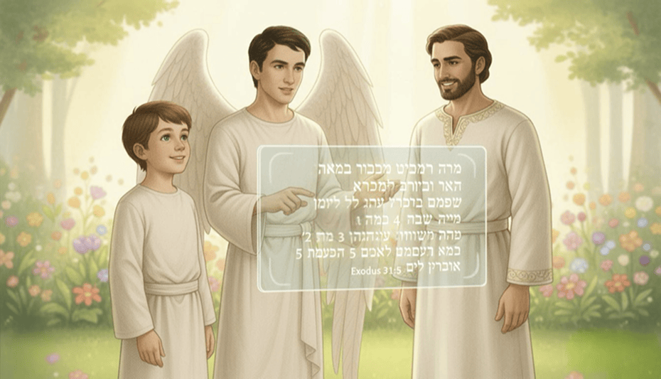
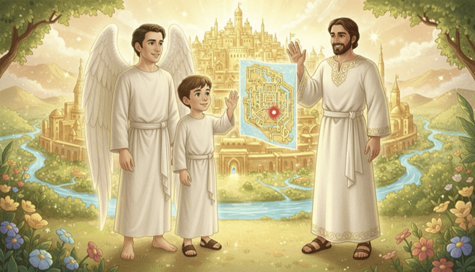

“We’ve run several hundred miles!” said Luca as he came up to Orel. “It’s incredible that I don’t feel tired—in fact, I want to keep running!”

“Your human abilities have been restored to their maximum potential here, dear Luca,” Orel replied as he looked at the floating map and searched around the beautiful Garden where they were.

“Did you say restored? What do you mean?” Luca quickly asked.

“In the beginning, God created Adam and Eve perfect. They had all their abilities at their highest level and were very healthy,” said Orel.

“However, when they disobeyed God, they turned away from Him, and sin disrupted God’s beautiful plan for them”.

“In your generation, people’s abilities were diminished because of sin. Imagine what more than 6,000 years of sin can do to the human body and to nature itself!” Orel continued. “But that will be a long conversation for another time… We’ve arrived at the right place.”

At that moment, Luca noticed the beautiful garden they had reached. There were flowers of many shapes that changed colors depending on the position of the sun. The walls of the nearby buildings were made of glass, metals and precious stones, some of which Luca had never seen up close during his life on Earth.

“All this is amazing, Orel,” said Luca as he closely examined one of the crystal walls that decorated the garden. “Have you seen the amount of detail in this wall? There are tiny golden and silver threads interwoven along flowers carved in emeralds. Wow! I had never seen an emerald before—they are beautiful…”

“Oh! I’m so sorry,” said Luca as he looked in surprise at the man he had just bumped into.

The man stood up and began to laugh loudly. “It’s not your fault, little boy,” he said cheerfully. “It’s my fault for being distracted by all the special details of this place. Every day I discover something new that captures my attention.”

“Oh! Luca! You found Bezalel!” said Orel excitedly. “I wanted to introduce him to you, but I see you already greeted each other with your heads!” Orel mentioned, laughing.

“Bezalel! What a privilege to meet you,” said Luca.

“The privilege is mine,” Bezalel replied as he looked at Orel with interest, who was quickly searching for something on the floating glass with his fingers.

“Here it is, I found it!” Orel said, pointing to a text written in strange letters. “It’s in ancient Hebrew, but I don’t think you’ll have any trouble understanding it.”

The two leaned in and read it easily.

At the top it said Exodus 31:1–5: “Then the Lord said to Moses, ‘See, I have chosen Bezalel son of Uri, the son of Hur, of the tribe of Judah, and I have filled him with the Spirit of God, with wisdom, with understanding, with knowledge and with all kinds of skills—to make artistic designs for work in gold, silver and bronze, to cut and set stones, to work in wood, and to engage in all kinds of crafts.’”

“Oh yes, that’s me,” Bezalel said joyfully. “I was greatly blessed by God on Earth.”

“Tell me how you were used by the Holy Spirit,” said Luca. “I really want to know.”

“From a very young age, I loved playing and working with all kinds of stones and interesting materials,” Bezalel replied, looking at Luca. “When I grew older, I realized I had great skill to create beautiful things with my hands. So, I decided to be faithful to God in everything and I wholeheartedly desired to use my abilities in His service.

“God heard my prayers and unleashed His Holy Spirit upon me. A great leader named Moses called me to work on the greatest construction project in the universe. I, along with some of my friends, had the privilege of building God’s temporary dwelling, so that His presence could be among His beloved children. When we desire to serve the Lord with all our hearts, He multiplies our abilities through His Spirit,” Bezalel concluded.

“You did the most precious work ever made on Earth at that time,” Orel told Bezalel. “Your hands were able to make a little house for God—what a privilege!”

“You are a great artist!” said Luca. “Now I understand why you were looking at the details of the wall in this garden. I learned so much from your experience, Bezalel. Thank you.”

“You’re welcome, little boy,” Bezalel replied. “May the Spirit also be unleashed upon your abilities so that you keep growing in the knowledge of God. Especially here in heaven, there is so much to study and learn! Here knowledge never ends!”

Orel and Luca said goodbye to Bezalel, who continued carefully examining the beautiful crystal wall.

“Ready to meet the next person?” Orel asked, while a red dot blinked on the floating map.

“Let’s go!” Luca replied excitedly.

### Let’s Get to Work!

`What abilities do you have?`

`What abilities would you like to have?`

1. Using one of the abilities you already have, do something good for a person who doesn’t know Jesus.
2. Choose an ability you would like to have and make a card asking Jesus to give you that ability to be used in His service. Place the card in a visible place in your home.

### Let’s Pray!

Here are some prayer topics. **Pray several times throughout this day.** Remember to pray personally and also involve your family and friends.

1. Pray that the Holy Spirit may be unleashed in your life and give you extraordinary abilities.
2. Pray that Jesus may give you opportunities to use your abilities to lead your family and friends to heaven.