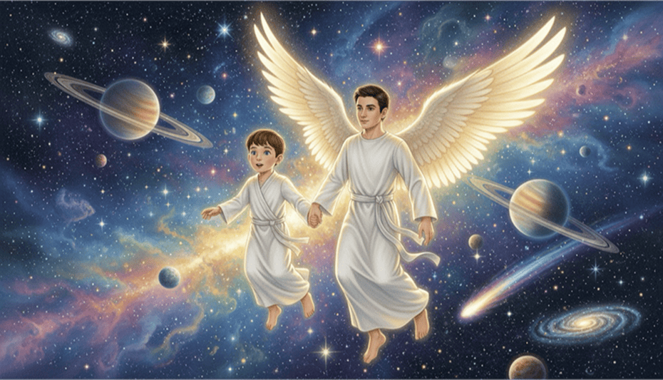
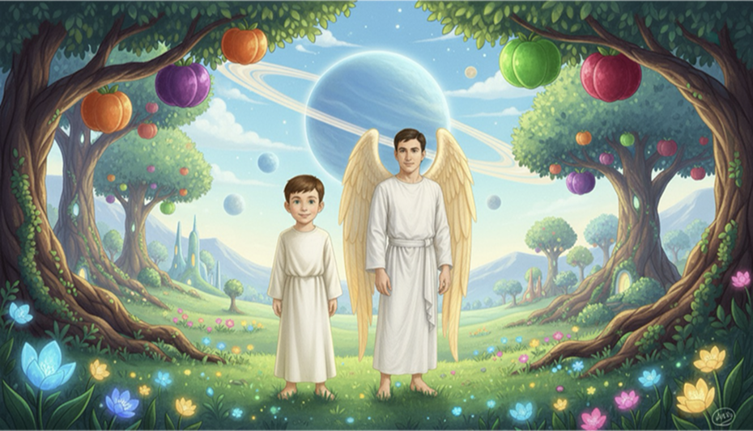
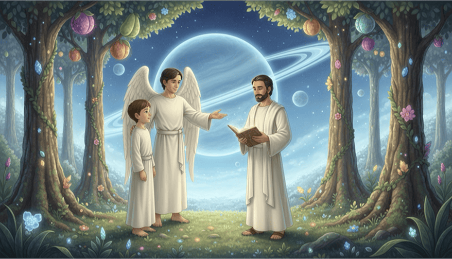
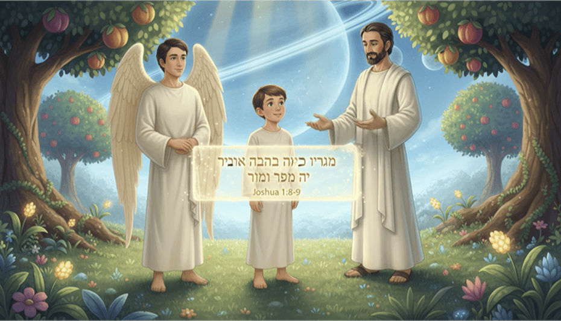
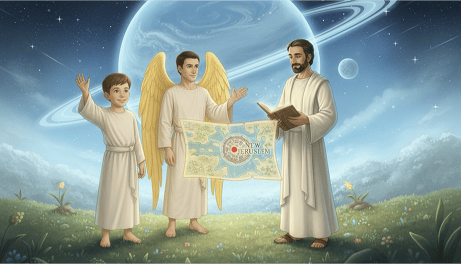
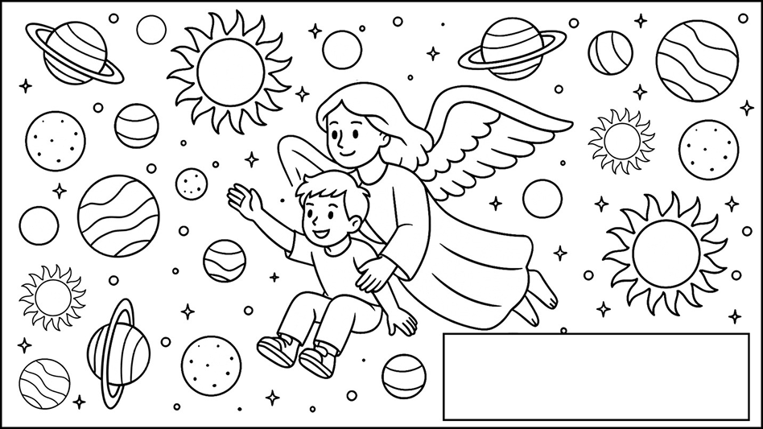

“Hold on tight,” said Orel. “We’re about to arrive.”

Luca looked everywhere while holding Orel’s hand firmly. They were flying through the vastness of space. Luca had seen incredible things! They passed close to stars made of fire, and nothing happened to them. Wow!

At first, Luca had been counting the number of planets, but after a while, he lost track of the endless lights, colors, and flashes of the stars. They had already been traveling for several days. This was out of this world!

“We’ve arrived,” said Orel as they approached a huge sky-blue planet with rings and several moons. “We’re going to enter here,” he said, pointing to a part of the planet. Their descent was quick. In just minutes, they were standing in a beautiful valley full of enormous trees with delicious-looking fruit.

“I’ve been waiting for you,” said a calm voice. “I’ve been here for a few days. My friend Moses told me you were coming, so I took a break to meet you.”

“Thank you so much for waiting for us!” Orel quickly replied. “Dear Luca, I present to you Joshua, the successor of Moses and the man who led the Hebrews into Canaan, the Promised Land, at that time.”

“Wow! You were one of my favorite Bible characters! What a privilege to meet you, Joshua!” Luca said happily. “I think you were the favorite of many people on Earth.”

“It’s not that big of a deal,” Joshua answered cheerfully. “God gave me many privileges in my earthly life. Praise His Name forever! I tried to do God’s will by following His Word.”

“That’s right!” Orel said as he brought up the floating glass with a Bible text highlighted. “Joshua, we’re investigating what the Holy Spirit did when He was unleashed on Earth, and I found an interesting reference about you.”

Orel began to read Deuteronomy 34:9, “Now Joshua son of Nun was filled with the spirit of wisdom because Moses had laid his hands on him. So the Israelites listened to him and did what the Lord had commanded Moses.”

“Oh yes! I remember that day. I was very nervous,” said Joshua. “My friend Moses told me that the Lord had chosen me to be the new leader of the Hebrew people. How was I supposed to replace the great Moses?! I felt unworthy, but the Spirit was unleashed upon me and strengthened me. God gave me the secret to be victorious in life.”

“Let me show you,” Joshua said, searching for another text in Orel’s floating glass. “I wrote it in my book of the Bible. Here, here it is—the secret, in Joshua 1:8–9.”

He began to read with great emotion, “Keep this Book of the Law always on your lips; meditate on it day and night, so that you may be careful to do everything written in it. Then you will be prosperous and successful. Have I not commanded you? Be strong and courageous. Do not be afraid; do not be discouraged, for the Lord your God will be with you wherever you go.”

“The most important thing I learned through the Holy Spirit,” Joshua said excitedly, “was that I must always study the Bible. That was my secret to leading the people. Every day I sought the outpouring of the Spirit in my life by meditating on the Words of God.”

“It’s true, Joshua!” Luca said. “I remember when I learned to read, Mom and Dad encouraged me to read the Bible every day. I learned so much about God’s love! There were things I didn’t understand at first, but little by little I came to understand them.”

“Exactly! That happens because the Spirit is unleashed upon those who want to know God, and He helps them understand the Bible,” Joshua said reverently. “The Holy Spirit inspired the writing of the Bible, and it is the same Spirit who delights in revealing Jesus.”

“I loved watching you study the Bible since you were little, dear Luca!” Orel said earnestly. “You couldn’t see me, but I was there, happy, knowing you were a boy with a good heart, seeking Jesus.”

“Thank you, Joshua, for reminding me of those beautiful moments I spent reading the Bible,” Luca said to Joshua. “And thank you, Orel, for your company. The Bible already told me I wasn’t alone, ‘the angels of the Lord’ were by my side. Wow!”

“Little one, how wonderful that you made the Bible your map,” Joshua said cheerfully. “That’s why you’re in heaven—because you came to know personally the Author, who is Jesus.

“What is Orel doing?” Said Joshua.

“We have to go, Luca. I already have our next destination,” Orel said, showing the floating map with another blinking red dot. “It seems we’re going back to the New Jerusalem.”

“Oh, how nice!” Joshua said. “I’ll be heading back there soon. I’m in a race with my mission partner, I think you know him, his name is Caleb. On Earth, he loved conquering mountains. Here, he wants to be the first to explore all the worlds!” Joshua laughed heartily. “Well, I must go too. Caleb is already a few days ahead of me. Safe travels, friends!”

“Safe travels, Joshua!” Orel and Luca said at the same time.

And once again, they traveled faster than the speed of light through the universe.

### Let’s Get to Work!

Read Hebrews 1:2 and paint the image of the great journey through the universe. In your own handwriting, write in the box the phrase: **“I will travel through the universe.”** Cut out the image and place it somewhere visible in your house or room.

### Let’s Pray!

Here are some prayer topics. **Pray several times throughout this day.** Remember to pray personally and also involve your family and friends.

1. Pray that the Holy Spirit may be unleashed in your life and give you the desire to study the Bible every single day.
2. Pray that the Holy Spirit may help you know Jesus through the Bible.