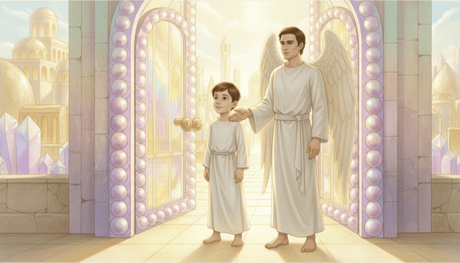
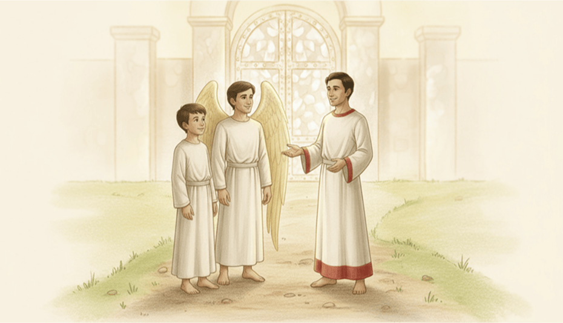
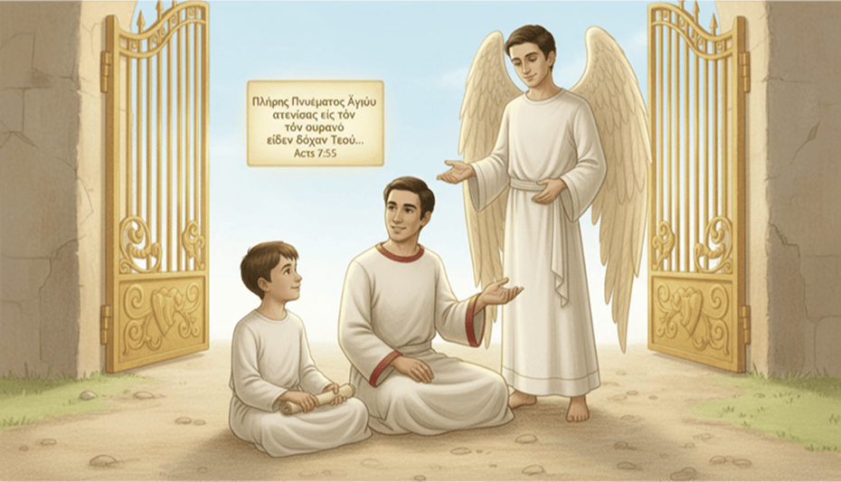
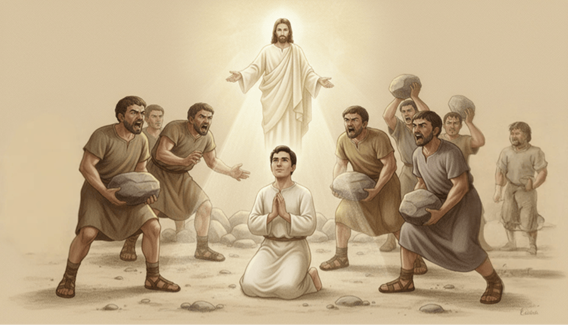
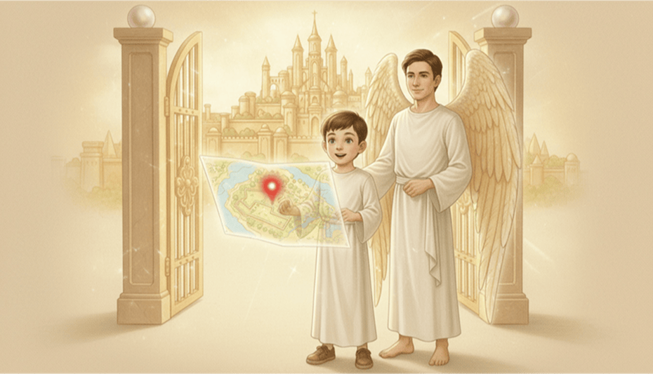

“They’re made of pearls!” Luca exclaimed in amazement as he passed through one of the enormous gates of the New Jerusalem.

“Gates of pearls! Wow! If you look at them from one side, they look pinkish… If you tilt your head, they turn violet… And if you look at them straight on, they seem whitish with a touch of greenish-blue.”

“Impressive, isn’t it?” Orel said. “There are twelve gates—three on each side of the City—and every one of them is just as beautiful. I’ve already seen them all.”

“Jesus really is a genius architect,” Luca laughed as he tried to spot a new reflection color in the gate they had just passed through.

Not far from them stood a man, facing the horizon with his head lifted high.

“Come on, Luca, I’ll introduce you to Stephen,” Orel said, walking toward him.

“Orel… his robe has the same red border at the bottom as the one John was wearing,” Luca said curiously. “I haven’t seen many robes like that. Mine is completely white. What does it mean?”

“Hello, Stephen,” Orel said. “We’re glad to find you.”

“Oh, hello servants of the Lord!” Stephen answered tenderly. “You are an angel, and you—a redeemed one. May I know who you are?”

“My name is Luca, and this is my angel Orel,” Luca answered immediately. “It’s a great honor to meet you, Stephen. We are on a journey learning about the works of the Holy Spirit unleashed in people’s lives.”

“What a beautiful adventure! I think I’ll do the same too,” Stephen said, excited. “The Spirit was unleashed in my life when I accepted Jesus, and He led me through very intense and important moments. He also powerfully comforted me when my end came.”

“A moment ago, Luca was asking about the difference in your robe,” Orel said, pointing to the red border at the hem of Stephen’s robe.

“It is a special distinction of honor given to us by Jesus,” Stephen replied solemnly. “It represents those of us who gave our lives for our faith in Jesus. On Earth, they called us martyrs; here in heaven, we are a symbol of faithfulness to Christ. The red color represents our blood, shed for doing the work of Jesus.”

“Stephen is considered the first Christian martyr,” Orel told Luca while searching for a text on the floating glass where Bible verses appeared. “Luca, please read this, Acts 7:55.”

Luca read aloud. It was in ancient Greek, but by now he was used to reading ancient biblical languages: “But Stephen, full of the Holy Spirit, looked up to heaven and saw the glory of God, and Jesus standing at the right hand of God.”

“That was the last moment of my life on Earth,” Stephen said thoughtfully. “I went through much suffering for my faith in Jesus. At that time there were many people with evil intentions against those of us who followed Him.”

“The same happened in my time,” Luca said quickly. “Many people made life difficult for Christians who wanted to remain faithful to Jesus.”

“That’s right! You wanted to know about the work of the Spirit in my life,” Stephen continued. “It’s truly incredible… The Holy Spirit was unleashed upon me, and I became a great evangelist of Jesus. I was a powerful instrument in His hands. Many people came to Christ through the miracles the Spirit did through me.

“The opposition and suffering I constantly faced meant nothing to me, because I knew my good Jesus would one day bring me to live with Him in the New Jerusalem for eternity. And so it happened!

“At the end of my earthly life—in the moment of greatest fear and suffering—the Spirit was unleashed upon me and gave me the vision of Jesus waiting for me in heaven. With that assurance in mind, I felt nothing of my enemies’ attack… I closed my eyes and fell asleep in the rest of the righteous.

“When I opened my eyes again, I was restored, and I found Jesus right here, at this very gate of the City, and He welcomed me! That’s why I come here so often. It reminds me of how good Jesus has been to me. He Himself gave me this robe with the red border. I feel so undeserving of such honor.”

“What an extraordinary story, Stephen!” Luca said, with tears in his eyes. “I can only imagine what you went through for Jesus.”

“We learned that the Holy Spirit accompanied and comforted the faithful followers of Jesus,” Orel said as he activated the floating map. “Thank you so much for your time, Stephen.”

“It was my privilege to share this moment with you,” Stephen said with a big smile. “Come back anytime.”

“Where are we going now, Orel?” Luca asked, looking at the blinking red dot to the south of the City. “Another spiritual adventure? I’m learning so much from these conversations! Who will surprise us next? Let’s go!”

### Let’s Get to Work!

Use your creativity to make a special card with a message of encouragement for someone who is going through hard times. Tell them that Jesus loves them and wants to be with them forever. Ask your parents, pastor, or teacher to help you deliver the card.

### Let’s Pray!

Here are some prayer topics. **Pray several times throughout this day.** Remember to pray personally and also involve your family and friends.

1. Pray that the Holy Spirit may be unleashed in your life and give you strength to go through the problems you may face.
2. Pray that the Holy Spirit may help you always trust in Jesus.