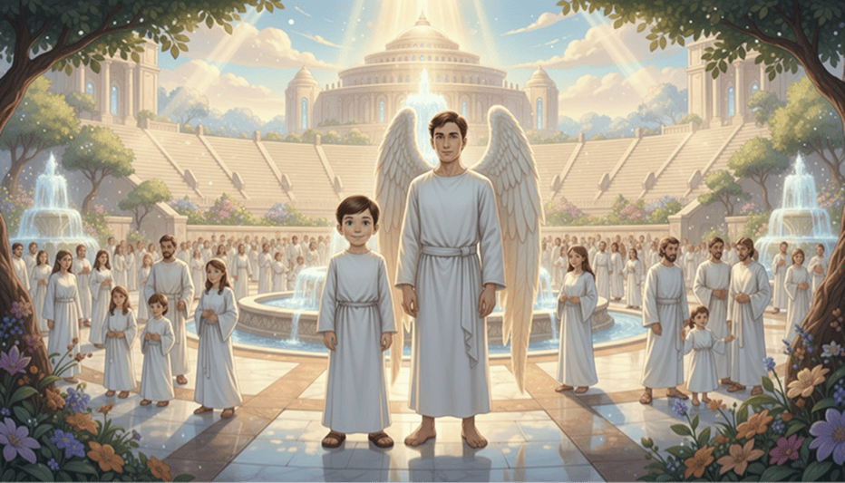
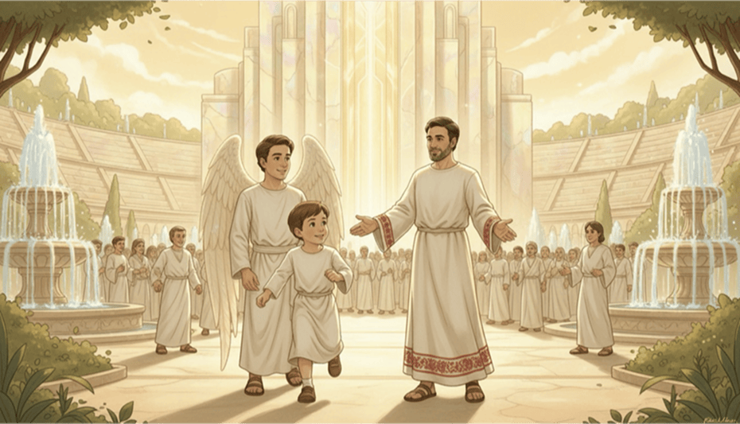
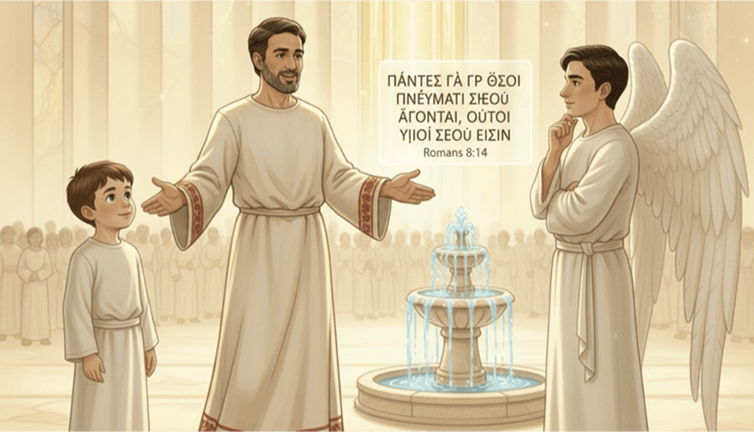
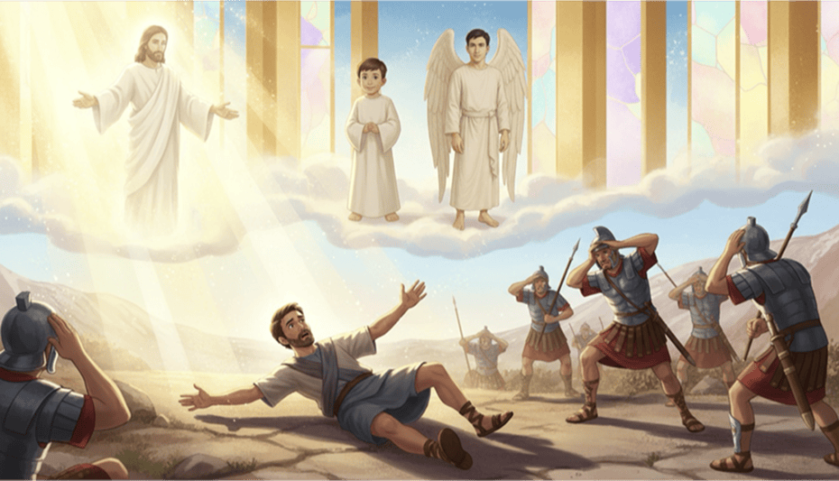
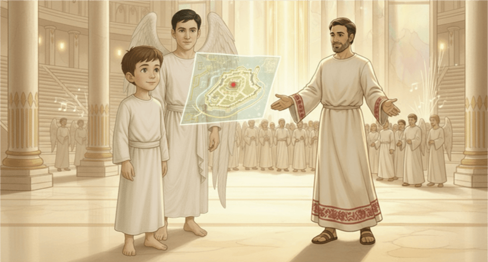
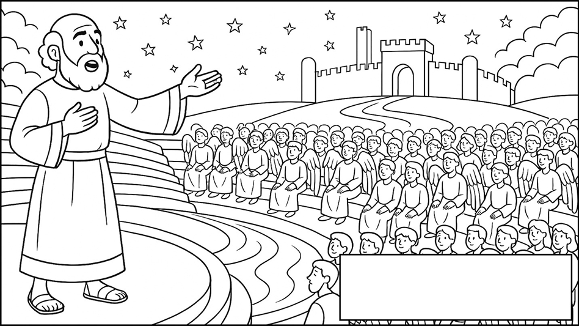

“Welcome to the Central Plaza of the New Jerusalem,” Orel said to Luca.

“Look at the fountains! What a beautiful place this is!” Luca exclaimed as he ran to examine a huge fountain with flower designs in the center of the Plaza.

“There are so many people here. Over there I see some kind of amphitheater, and many of the redeemed are listening very attentively to someone speaking,” Luca said, trying to see and hear as much as he could, as quickly as possible.

“We need to go there,” Orel said, pointing to the central amphitheater. “There must be more than a million redeemed gathered now. Let’s wait a little to speak with the one at the front.”

“Orel, what is that over there?” Luca pointed toward a huge building at one end of the Plaza. At its entrance, the image of an open book floated over a pillar.

“I’ll show you that place later,” Orel said. “It’s called the Celestial Record Room, and it is where the life stories of every human being who lived on Earth are kept.”

At that moment, applause and hallelujahs resounded throughout the plaza. The speaker had finished his message, was stepping down from the platform, and now the angelic songs of praise were beginning.

“Come on,” Orel said, taking Luca by the hand. Both of them, almost running, went after a man dressed in a white robe with a red border at the hem. They found him behind the amphitheater.

“Paul! Paul!” Orel called out toward the man. “Wait for us—we want to speak with you.”

The man, Paul, stopped, looked at them intently, and smiled merrily.

“Orel and Luca—is it really you?” Paul said, as if he already knew them.

“Wow!” Luca said, staring at Orel in amazement. “How do you know us?” he asked.

“My good friend Stephen told me you had met with him and that you were seeking people who had experienced the Holy Spirit,” Paul said, still smiling. “So, I thought it was only a matter of time before you came looking for me.”

“You’re incredible, Paul!” Luca said excitedly. “I always admired you. You were such a powerful example to me on Earth.”

“Oh, Luca!” Paul said. “Your words move me. But I was only a simple mortal who received the privilege of being a soldier of Jesus.”

“Not just a soldier, I’d say,” Orel added. “But the greatest commander in the army God ever had on Earth.”

“My friends, your words flatter me,” Paul laughed. “But to God be the glory—only to the Supreme Commander, Jesus! No one else but Him!”

Orel brought up a verse on the floating glass—Romans 8:14, “For those who are led by the Spirit of God are the children of God.”

“Paul, please explain to us—how did the Spirit transform people into children of God?”

“What a marvelous question!” Paul said. “It is a very deep theological question. But in simple terms, I would say that all who were baptized received the blessing of the Holy Spirit. At that moment, the Spirit began a silent and transforming work in the human heart.

“Thus, every person who accepted Jesus as their Savior, was baptized, and lived following in His steps, became part of the family of God. That’s why we are all here! In the New Jerusalem, we are all children adopted by Jesus.

“The unleashed Spirit makes us children of God,” Paul concluded.

“It was a little hard to understand, but I think I got it in the end,” Luca said, scratching his head. “I was adopted into the family of God by the power of the Holy Spirit, is that right?”

“Exactly!” Paul said. “Even I was adopted. Can you imagine what my life would have been if Jesus had not found me on the road to Damascus? I shudder just thinking about it.”

“Let’s give thanks to God for having considered us worthy of His grace,” Orel said. “Dear Paul, I think you must go back to the amphitheater now—there are some of the redeemed signaling for you to return to them.”

“Oh yes! Excuse me, my friends… duty calls!” Paul winked at Luca and walked away.

“Paul is a man of great intellectual ability,” Orel said. “On Earth, God used him to preach to the mighty and powerful. Here in heaven, his abilities are increased, and he is able to converse about fascinating things even with the angels. Everyone wants to hear him!”

“I want to talk with Paul again,” Luca said. “I have so many questions for him… Where are we going now, Orel?”

“To a place I think you know very well, little Luca,” Orel said with a calm, gentle voice. “It will truly be an honor to travel with you again.”

### Let’s Get to Work!

Color the picture of Paul speaking in the New Jerusalem. In the box, write: **“In Heaven I will meet my favorite Bible characters.”** Cut out the drawing and place it somewhere visible in your home or room.

### Let’s Pray!

Here are some prayer topics. **Pray several times throughout this day.** Remember to pray personally and also involve your family and friends.

1. Pray that the Holy Spirit may be unleashed in your life and make you part of the family of God.
2. Pray that the Holy Spirit may help you remain faithful in the family of Jesus.