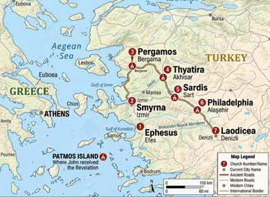

[[Revelation 1:1-4]]

- {"style": {"block": {"backgroundColor": "#F1E5DA", "padding": {"top": "sm", "start": "base", "end":"sm", "bottom": "sm"}}}}
- Revelation is addressed to seven “churches”—that is, to seven gatherings of Christ’s followers, all located in what is today the nation of Turkey.
- There were far more than seven churches in the first century A.D. But the number seven was then considered the number of perfection, meaning completeness. Thus, the seven churches symbolized the complete number of all Christ’s followers everywhere.
- It’s also clear that Revelation’s message goes far beyond Christ’s followers to all the world, because events affecting all of humanity are described in its pages.
- Thus, while originally addressed to first-century churches, if you are reading this book today, it is written to you.

[[Revelation 1:4-7]]

- {"style": {"block": {"backgroundColor": "#F1E5DA", "padding": {"top": "sm", "start": "base", "end":"sm", "bottom": "sm"}}}}
- In the book of Revelation, references to those who live “on the earth” or are “of the earth” are nearly always references to those who are disobedient to God. This is why here in verse 7 there is mourning rather than celebration when Jesus returns to earth the second time.

[[Revelation 1:8-11]]

- {"style": {"block": {"backgroundColor": "#F1E5DA", "padding": {"top": "sm", "start": "base", "end":"sm", "bottom": "sm"}}}}
- In verse 10 John uses the phrase “the Lord’s Day.” Some have thought that this is a reference to the first day of the week, Sunday. But it is instead a reference to the seventh day of the week, Saturday, a day also known to John and the rest of Jesus’ followers as the “Sabbath.” To learn more, please **[click here 🔗](https://thingsnew.org/en/r01/)**.

[[Revelation 1:12-20]]

- {"style": {"block": {"backgroundColor": "#F1E5DA", "padding": {"top": "sm", "start": "base", "end":"sm", "bottom": "sm"}}}}
- Jesus’ words in verse 18 are deeply important: “I am He who lives, and was dead, and behold, I am alive forevermore.” The fact that Jesus died, was buried in the grave, and came back to life by His own power is what sets Him apart from every other being who has ever lived. And because of that triumph, He now offers victory over death and sin to anyone who is willing to accept him as Savior and Lord.
- Since Christ’s death and resurrection are so central to who He is and what He wants to do for humanity, Revelation will reference those events repeatedly in both literal and symbolic ways.