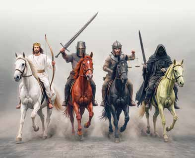

[[Revelation 6:1-2]]

- {"style": {"block": {"backgroundColor": "#F1E5DA", "padding": {"top": "sm", "start": "base", "end":"sm", "bottom": "sm"}}}}
- Most of the seals, when opened, reveal scenes that generally correspond to the same eras of church history revealed through the seven churches in chapters 2 and 3.
- In the first seal the color of the horse (white, showing purity) and the fact that its rider has a crown indicates this is most likely Christ, who led the apostolic church to success in spreading the message of salvation.
- This seal corresponds to the period foreshadowed by the church in Ephesus, from A.D. 31 to about A.D. 100.
- Christ “conquered” during this time, not actual armies with swords and spears, but conquered evil with love and compassion as His followers spread the news of His salvation to the world.

[[Revelation 6:3-4]]

- {"style": {"block": {"backgroundColor": "#F1E5DA", "padding": {"top": "sm", "start": "base", "end":"sm", "bottom": "sm"}}}}
- “Fiery red” represents two things: heresy coming in (teachings that oppose God’s will—a corruption of the white/pure faith shown in the first horse) and the shedding of blood. Both interpretations can apply to the experience of Christ’s followers from about A.D. 100 to A.D. 313. As we learned previously, Christ’s followers then were terribly persecuted by the Roman government. It was also a time during which various corrupt beliefs entered the wider church.

[[Revelation 6:5-6]]

- {"style": {"block": {"backgroundColor": "#F1E5DA", "padding": {"top": "sm", "start": "base", "end":"sm", "bottom": "sm"}}}}
- If red indicates corrupted belief, black would indicate a faith profoundly contaminated and turned into darkness. The pure belief in Christ symbolized in the first seal is now completely gone.
- This seal corresponds to the Pergamos era, or about A.D. 313 to A.D. 538. That was a time of great “famine,” not of physical food, but spiritual—lacking knowledge of God’s Word. The church also became entangled with the state powers, and the good news of salvation through Jesus was obscured.
- For more about the third seal’s other symbols, **[click here 🔗](https://thingsnew.org/en/r06a/)**.

[[Revelation 6:7-8]]

- {"style": {"block": {"backgroundColor": "#F1E5DA", "padding": {"top": "sm", "start": "base", "end":"sm", "bottom": "sm"}}}}
- This seal symbolizes the Thyatira era of God’s followers, from A.D. 538 to A.D. 1517.
- Thousands of Christ’s followers then were slaughtered by the collaboration of earthly governments and unfaithful church leaders.
- But note the promise: Evil forces are granted power over “a fourth of the earth” only. Destruction, both spiritual and physical, would not be permitted to become complete.

[[Revelation 6:9-11]]

- {"style": {"block": {"backgroundColor": "#F1E5DA", "padding": {"top": "sm", "start": "base", "end":"sm", "bottom": "sm"}}}}
- Seals 5 through 7 mark a shift. Seals 1-4 focused on the successes and obstacles faced by the followers of Christ. But the remaining three seals focus on how Jesus would respond to those who oppress His followers.
- Recall that the phrase “those who dwell on the earth” (verse 10) is generally used in Revelation to refer to those who are opposed to God and His people.
- The fifth seal corresponds to the Sardis church era of about A.D. 1517 to A.D. 1720. But again, its focus is on Jesus’ developing response to those who oppress His people, rather than on His people themselves.
- To learn about the symbolic nature of the “souls” that are “under the altar,” **[click here 🔗](https://thingsnew.org/en/r06b/)**.
- Jesus promises salvation (the “white robe”) to all who have given their lives for Him. Victory is coming, even when times seem so dark!

[[Revelation 6:9-11]]

- {"style": {"block": {"backgroundColor": "#F1E5DA", "padding": {"top": "sm", "start": "base", "end":"sm", "bottom": "sm"}}}}
- The sixth seal corresponds in part to the period symbolized by the church of Philadelphia, beginning in the 1720s.
- But it also clearly exceeds that period, for the events it reveals extend to the very end of time, when changes in the sky and the earth’s geography will make the planet uninhabitable.
- For more on the eighteenth- and nineteenth-century religious awakenings and the signs predicted here in the sun, moon, and stars, **[click here 🔗](https://thingsnew.org/en/r06c/)**.
- Jesus is incredibly patient. He has allowed those who live on the earth to make evil choices and to oppress His followers for about 2,000 years. But the sixth seal shows that at last, just prior to His second coming, those days of oppression will end. The “wrath of the Lamb” will come at last. After all His offers of mercy and forgiveness have been rejected, Christ will destroy both the surface of the earth and those who have harmed His people.
- Justice, indeed, is coming.