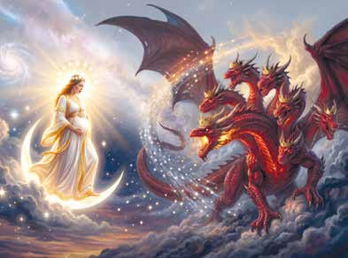

[[Revelation 12:1]]

- {"style": {"block": {"backgroundColor": "#F1E5DA", "padding": {"top": "sm", "start": "base", "end":"sm", "bottom": "sm"}}}}
- As noted previously, Revelation is written in a chiastic structure (see Introduction). This means that with chapters 12-14 we are now entering into the part of the book that was the core reason Revelation was written.
- The pure woman of chapter 12 represents the totality of God’s followers during both Old and New Testament times.

[[Revelation 12:2]]

- {"style": {"block": {"backgroundColor": "#F1E5DA", "padding": {"top": "sm", "start": "base", "end":"sm", "bottom": "sm"}}}}
- The “woman,” God’s followers, are shown here as giving birth to Jesus Christ, who, as we have seen, was born in the first century A.D.

[[Revelation 12:3]]

- {"style": {"block": {"backgroundColor": "#F1E5DA", "padding": {"top": "sm", "start": "base", "end":"sm", "bottom": "sm"}}}}
- This dragon represents Satan working through pagan Rome (see verses 4 and 9).

[[Revelation 12:4-5]]

- {"style": {"block": {"backgroundColor": "#F1E5DA", "padding": {"top": "sm", "start": "base", "end":"sm", "bottom": "sm"}}}}
- “Stars” in both the Old and New Testaments can refer to angels (Job 38:7; Isaiah 14:12; Revelation 1:16, 20, etc.). Thus, in verse 4, Satan is recorded as having taken one third of the angels of heaven with him in his rebellion against God. This happened prior to the creation of the world (more detail on this is given in verses 7-9).
- Though Satan, working through pagan Rome, wanted to “devour,” or destroy, Jesus as soon as He was born, an angel warned Joseph to take Mary and the baby Jesus to Egypt, because King Herod, who was the Roman official ruling in Israel at that time, wanted to kill Him (see Matthew 2:13-16). Despite Satan’s efforts, Jesus, by His death on the cross and resurrection, successfully completed His mission to make salvation available to humanity.
- Shortly after His resurrection, Jesus “was caught up to God [the Father] and His throne” to be our bigh priest and prepare us for His return to earth.

[[Revelation 12:6]]

- {"style": {"block": {"backgroundColor": "#F1E5DA", "padding": {"top": "sm", "start": "base", "end":"sm", "bottom": "sm"}}}}
- Once again, the 1260-year prophecy of Daniel 7 is mentioned so that Revelation’s readers are aware of why “the woman”—that is, the church of Christ’s followers—is fleeing into the wilderness. They are trying to escape from papal persecution during the Papacy’s initial reign from A.D. 538 until 1798.
- But now in verse 7 the clock in our story turns back for just a moment to a most unusual kind of war:

[[Revelation 12:7-9]]

- {"style": {"block": {"backgroundColor": "#F1E5DA", "padding": {"top": "sm", "start": "base", "end":"sm", "bottom": "sm"}}}}
- This war in heaven looks back at the origin of Satan, who was once a holy angel (see Isaiah 14:12-15). To learn more, please **[click here 🔗](https://thingsnew.org/en/r12/)**.

[[Revelation 12:10-16]]

- {"style": {"block": {"backgroundColor": "#F1E5DA", "padding": {"top": "sm", "start": "base", "end":"sm", "bottom": "sm"}}}}
- Satan pursues the true followers of Jesus during the 1260 years using a “flood” of papal persecution. But the persecution does not destroy Christ’s followers, for the “earth” (verse 16), or wilderness, “helped” her.
- This remained true for centuries, as Christ’s followers, most notably the Waldenses, hid in the wilderness to escape their persecutors.

[[Revelation 12:17]]

- {"style": {"block": {"backgroundColor": "#F1E5DA", "padding": {"top": "sm", "start": "base", "end":"sm", "bottom": "sm"}}}}
- Satan in verse 17 goes to war against Christ’s followers in the time of the end, specifically those here called “the rest of her offspring.”
- The Greek word (the book of Revelation was originally written in the Greek language) translated as “the rest of” is _loipon_, and it means “remnant”: the last part of something that used to be much bigger.
- Verse 17 crucially points out that this relatively small remnant church, this final group of Jesus’ followers on earth prior to His second coming, will be comprised of all those who do at least two things: keep God’s commandments and have “the testimony of Jesus.”
- Revelation 19:10 identifies “the testimony of Jesus” as being “the spirit of prophecy.” In other words, God’s last-day church will be a remnant people that (a) take all of God’s ten-commandment law seriously, as originally written; and (b) take the gift of prophecy seriously and have the gift of prophecy at work in their midst.
- Do you take God’s law and His prophecies seriously?
- If not, why not start today? And why not begin looking for God’s remnant church—again, a church that takes all of God’s laws and His gift of prophecy seriously?
- The gift of prophecy, being a gift of the Holy Spirit, is always in agreement with the Scriptures, which were inspired by the Holy Spirit.
- The finest hour of Christ’s followers lies just before us! And He is calling you to be a part of that finest hour.
- By His strength, you will not be beaten by Satan at the end of time, but instead will find a home with Jesus in heaven.