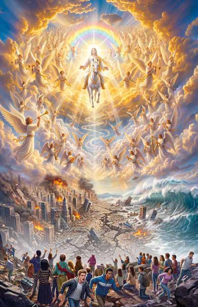

[[Revelation 19:1-8]]

- {"style": {"block": {"backgroundColor": "#F1E5DA", "padding": {"top": "sm", "start": "base", "end":"sm", "bottom": "sm"}}}}
- Chapter 19 starts with celebration! Babylon is defeated, and the great “wedding” that brings Christ and His true followers together, after waiting for thousands of years, will at last come to pass!

[[Revelation 19:9-10]]

- {"style": {"block": {"backgroundColor": "#F1E5DA", "padding": {"top": "sm", "start": "base", "end":"sm", "bottom": "sm"}}}}
- Verses 11-21 will now once again take us backwards in time to revisit the battle of Armageddon, this time from heaven’s point of view.

[[Revelation 19:11-16]]

- {"style": {"block": {"backgroundColor": "#F1E5DA", "padding": {"top": "sm", "start": "base", "end":"sm", "bottom": "sm"}}}}
- This rider is Jesus Christ.

[[Revelation 19:17-21]]

- {"style": {"block": {"backgroundColor": "#F1E5DA", "padding": {"top": "sm", "start": "base", "end":"sm", "bottom": "sm"}}}}
- The organizations of the Papacy (the beast) and the United States (the false prophet) will be destroyed. Jesus will be victorious. Evil’s reign on earth will be ended.

