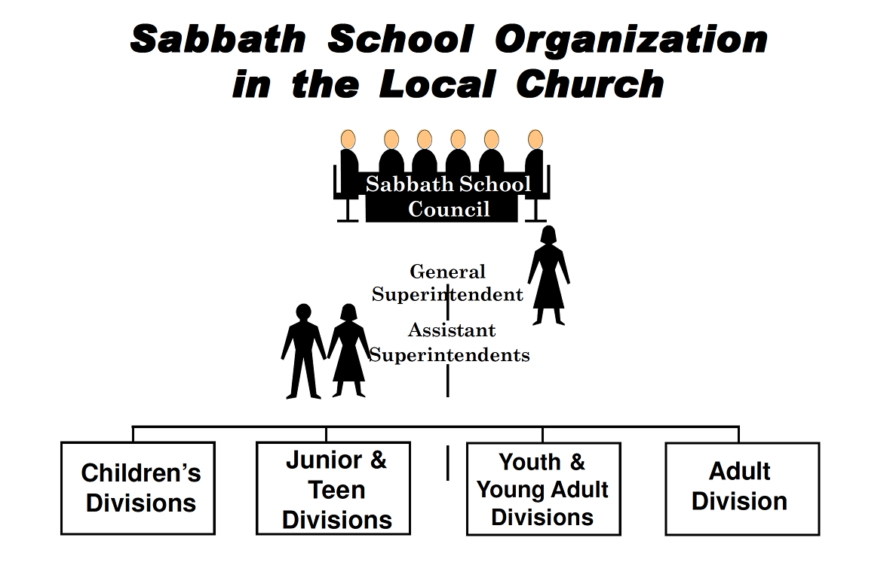

Bible Study Guides and auxiliary materials are provided for eight Sabbath School divisions. The ages indicated on the chart are approximate and correspond to generally accepted principles of childhood educational and spiritual development. The age groups for some departments may change, depending on how they are determined in a particular part of the world, often based on the local school system, the size of the church, or the number of children in the church.

#### Extension Division

The extension division cares for the needs of shut-ins and those who live in isolated places and cannot regularly attend church. The Sabbath School should make provision for attending to their needs and supplying them with Sabbath School Bible Study Guides.

### Sabbath School Divisions

Suggested age groups

| Division | Ages | Curriculum Materials |
| --- | --- | --- |
| Beginner | 0-2 | Beginner Bible Study Guide |
| Kindergrten | 3-5 | Kindergarten Bible Study Guide |
| Primary | 6-9 | Primary Bible Study Guide |
| Junior | 10-12 | PowerPoints |
| Teens | 13, 14 | Real-Time Faith |
| Youth | 15-18 | Cornerstone Connections |
| Young Adult | 18-35 | Collegiate Quarterly |
| Adult |  | Adult Bible Study Guide |

### Children’s Divisions

**Promotions.** Promotions from one division to another ideally take place twice during the year, but may take place any time according to the needs of a particular child, regardless of chronological age. Reading ability is not a criterion for promotion. Promotion Sabbaths for all divisions should be scheduled into the yearly church calendar.

**Beginners: Ages 0 - 2.** Where there are few children, the cradle roll (or beginners) may be combined with kindergarten. In large Sabbath Schools, this group may be further divided into Beginners A, from birth to 18 months, and Beginners B, 18 months through the third year.

**Kindergarten: Ages 3 - 5.** Where there are few children, the kindergarten may be combined with the primary division for the program part of Sabbath School. Even when the age groups are combined for the program section of Sabbath School, separate classes for the study of the lesson should be arranged.

**Primary: Ages 6 - 9.** Because children enter school at different ages, primary children should not all be expected to read. The program and teaching methods should be adapted to accommodate nonreaders.

### Junior and Teen Divisions

**Junior: Ages 10 - 12.** When there are few children, a combined junior/teen division may be formed for meeting the needs of children 10 - 14 years of age. It is advisable to join only the program section of Sabbath School and to have separate classes for the juniors and teens, using their own Bible Study Guides.

Local custom, maturation level, and the wishes of specific children should be considered when planning for promotion. Promotion should occur at the close of the school year.

**Teen: Ages 13 - 14.** When there are too few young people in this age group to have their own division, it is preferable to combine them with the juniors. Because of different developmental rates in youth of this age, the leader may advance or delay promotion to the youth department according to the needs of the individual.

### Youth and Young Adult Divisions

**Youth: Ages 15 - 18.** If there are few young people of this age, they should meet with the adults for the program and have their own lesson study as a group.

When the youth are combined with the adults, it is advisable to include them in the planning and presentation of Sabbath School programs. The Sabbath School Council needs to endorse youthful initiative and creativity, while giving guidance on how to maintain the basic objectives of the Sabbath School.

**Young Adult: Ages 19 - 30.** Where enough students of this age group are present, they should have their own division. Where the number of young adults is small, they meet with the adults but have their own lesson study time. Superintendents are encouraged to keep in mind the particular needs of young adults in planning their programs.

### Adult Division

The adults form an integral part of Sabbath School, and are a division just like any other.

The world Sabbath School system provides the adult division with the Adult Bible Study Guides in four editions:

- Student edition
- Teacher’s edition
- Easy Reading edition
- Large Print edition

The adult division also provides specialized program arrangements and materials for Sabbath School Action Units and small group activities.

**Extension Division.** This is the section of the adult Sabbath School that cares for the needs of shut-ins and people in isolated areas who cannot regularly attend Sabbath School. The Extension Division provides them with Sabbath School Bible Study Guides and makes provision for their needs.

