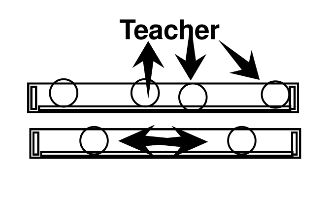
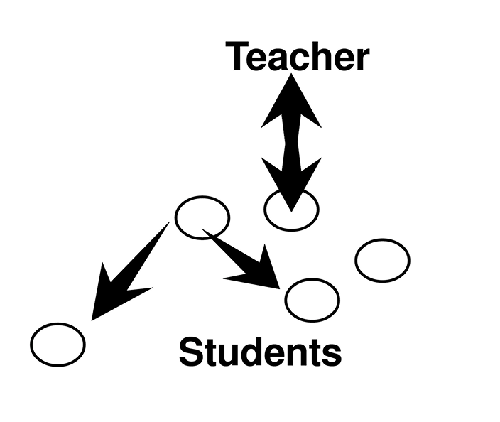
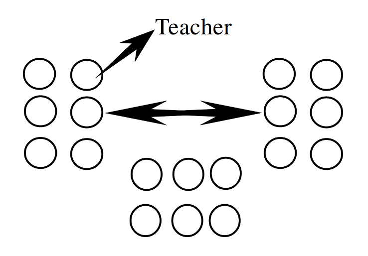
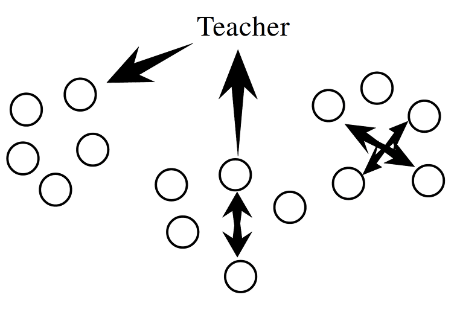
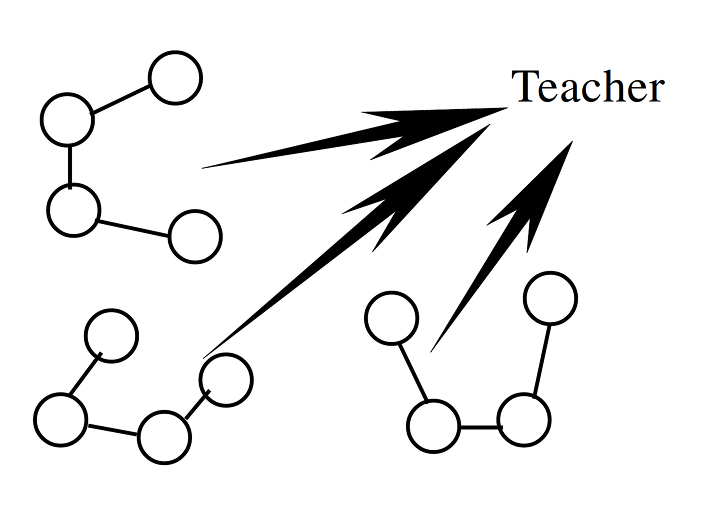

Seating arrangements make a great deal of difference in the effectiveness of teaching.

Most seating arrangements are dependent on the style of the church building. In some cases, Sabbath School classes meet in inadequate facilities that leave little choice of seating arrangements.

Nevertheless, some innovation and creative thinking will always find ways and means of improving even inadequate situations.

### Types of Seating Arrangements

#### Questions and Answer

#### Discussion Arrangement

### Small Groups

